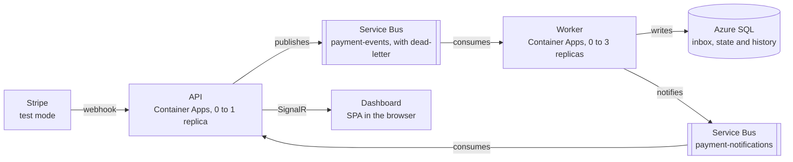

# Payment Webhook Processor (Azure) — Architecture

Version of October 12, 2026. Source of truth for the system design; the tasks are in [tasks.md](tasks.md).

## 1. Overview

The system receives Stripe webhooks in test mode, applies each event exactly once to the payment state, and shows that state live on a dashboard. The suggested repository name is `payment-webhook-processor`.

The problem is real: Stripe resends events when it doesn't get a timely response, may deliver the same event more than once, and doesn't guarantee delivery order. A naive system marks a payment as paid twice or regresses a refunded payment back to paid.

### What the project demonstrates

- **Asynchronous messaging with a reason:** the API responds to Stripe in milliseconds and the heavy work happens later, in a worker.
- **Reliability:** idempotency, tolerance to out-of-order events, bounded retry, and dead-letter with manual reprocessing.
- **Real time:** the dashboard is updated by push (SignalR), without polling.
- **Cloud operations:** containers on Azure Container Apps, queue-length scaling, managed identity, infrastructure as code, and a deploy pipeline.
- **Distributed observability:** a single trace follows the event from the API to the worker and the database.

### Out of scope

- Real billing: everything runs in Stripe test mode, with no real money.
- Multi-tenancy: there is a single Stripe account. Diopta covers that topic in the portfolio.
- User registration and access profiles: the dashboard has a single operator.
- Multi-region high availability: mentioned as an evolution, not built.

### Terms used in this document

| Term | Meaning |
| --- | --- |
| Event | A Stripe webhook, identified by `evt_...` |
| Payment | A Stripe PaymentIntent, identified by `pi_...` |
| Inbox | Table that records every received event and guarantees idempotency |
| Dead-letter (DLQ) | Service Bus subqueue for messages that exhausted their attempts or hit a permanent error |
| Requested state | The state an event leads the payment to, per the table in section 6 |
| Payment event | The parts of an event that matter to a payment: the payment, its requested state and its amounts |
| Duplicate | The same event (same `evt_...`) delivered again; it is already in the inbox, so nothing is written. Not the same as redundant, which is a different event that requests the state the payment is already in |
| Level | Rank of a state; an event is applied only if it raises the level of the payment, with the exceptions listed in section 6 |
| Final state | Canceled or refunded: accepts no transition |
| Outcome | What processing an event did to the payment: applied, ignored as out of order, redundant (the payment is already in the requested state) or conflict |
| Impossible conflict | An event that contradicts a fact already recorded, such as "paid" for a canceled payment; it goes to the dead-letter |
| Concurrency conflict | Two events for the same payment were processed at the same time and the other one wrote first; the losing one is processed again from the read. Not the same as an impossible conflict, which never succeeds on a retry |
| Transient error | A failure that a later attempt can fix, such as the database restarting, paused or throttling, or the network dropping; the event is retried with a wait. Not the same as a concurrency conflict, which is retried at once |
| Permanent error | A failure that no retry can fix: an unreadable event, an unsupported type or an impossible conflict; it goes straight to the dead-letter with the reason |
| Notification | The notice that the worker processed an event (applied, ignored, redundant or duplicate), sent from the worker to the API so the dashboard can update; it expires in 60 s and is never the source of truth. Also called notice in this document |
| Reprocess | Send a copy of a dead-lettered message back to the event queue and remove the original from the dead-letter; the inbox makes it safe even if the event was already applied |
| Poison message | A message that fails on every delivery with an error that is neither transient nor permanent; Service Bus moves it to the dead-letter after 5 deliveries. Not the same as a permanent error, which goes there on the first delivery |
| Demo fault | A failure forced on purpose by the `demo_fault` metadata of a test payment, to show retry, dead-letter or scaling; it only exists when fault injection is turned on |
| Valid event sequence | The distinct events of one payment's lifecycle, with no impossible conflict among them and a single highest event: the highest level and, among refunds, the largest refunded amount. Requires action and processing tied at the top, or two distinct events for the same state at the top, don't form one |
| Resulting state | The payment after every delivery of a sequence was processed. Not the same as a final state, which is canceled or refunded |

## 2. Requirements

### Functional

| # | Requirement |
| --- | --- |
| FR1 | Receive Stripe webhooks at `POST /webhooks/stripe` and reject those without a valid signature |
| FR2 | Respond `2xx` to Stripe before any business processing |
| FR3 | Apply each event to the corresponding payment exactly once, even if it arrives repeatedly |
| FR4 | Reach the correct final state even if events arrive out of order |
| FR5 | Keep the history of each payment, including ignored events and the reason |
| FR6 | Push every state change to the dashboard in real time |
| FR7 | List dead-lettered messages and allow reprocessing them from the dashboard |
| FR8 | Provide a simulator that generates test payments, duplicates, out-of-order events and failures |

The subscribed event types are `payment_intent.created`, `payment_intent.processing`, `payment_intent.requires_action`, `payment_intent.succeeded`, `payment_intent.payment_failed`, `payment_intent.canceled` and `charge.refunded`. Stripe recommends subscribing only to what the integration uses.

### Non-functional

| # | Requirement | Target |
| --- | --- | --- |
| NFR1 | Webhook response latency | p95 under 300 ms with a warm replica |
| NFR2 | Time from webhook to screen | p95 under 3 s with a warm worker |
| NFR3 | Event loss | Zero: either the event is applied or it is in the dead-letter |
| NFR4 | Monthly cost | Within the free allowances; budget alert at US$ 5 |
| NFR5 | Secrets | No credentials in the code, the image or the repository |
| NFR6 | Traceability | One trace ID links the webhook, the message, the processing and the notification |
| NFR7 | Reproducibility | Full local environment with one `docker compose up`, and infrastructure created only by Bicep |

The latency targets apply to warm replicas. With scale to zero, the first event after an idle period pays the cold start, and that is a cost choice recorded in the decisions.

## 3. Architecture

Two containers do all the work: the API receives and publishes, the worker consumes and writes. Between them there are two Service Bus queues, one for the events and another to tell the API that a payment changed.

The API and the worker are the project's code; everything else is a managed service. The path Stripe, API, queue, worker and database is the event's path, and the path worker, notification queue, API and dashboard carries the change back to the screen. Managed identity, Key Vault and Application Insights apply to both containers.

### Components

| Component | Azure service | Responsibility |
| --- | --- | --- |
| API | Container Apps, external ingress, 0 to 1 replica | Validates the webhook signature, publishes the event, serves the read API, hosts the SignalR hub and the dashboard files |
| Worker | Container Apps, no ingress, 0 to 3 replicas | Consumes the event queue, applies idempotency and the state machine, writes to the database and publishes the notification |
| `payment-events` queue | Service Bus, Basic tier | Holds events between the API and the worker; has a built-in dead-letter |
| `payment-notifications` queue | Service Bus, Basic tier | Carries the payment-changed notice from the worker to the API; messages expire in 60 s and are dropped, not dead-lettered |
| Database | Azure SQL Database, serverless free offer | Inbox, payments and history tables |
| Secrets | Key Vault | Webhook signing secret (`whsec_...`) and the dashboard admin key |
| Identity | Two managed identities (API and worker) | Passwordless access to Service Bus, the database and Key Vault |
| Telemetry | Application Insights on Log Analytics | Traces, logs and metrics from both containers |
| Images | GitHub Container Registry | Public images published by the pipeline |
| Migrations | Container Apps Job | Applies EF Core migrations on each deploy |
| Dashboard | SPA served by the API itself | Payment list, timeline, live feed and dead-letter screen |

### Why the API doesn't write to the database

On the webhook path, the API only validates and publishes. If publishing fails, it responds `500` and Stripe resends. This way ingestion doesn't depend on the database, which on the free offer pauses by itself and takes a few seconds to come back.

### Why the notification goes through a queue

The SignalR hub lives in the API, but the worker is the one that knows the payment changed. The second queue connects the two without a direct HTTP call and with the same managed-identity authentication. If nobody has the dashboard open, the API is at zero replicas and the notification simply expires.

## 4. Event flow

An event goes through ten steps between Stripe and the screen, and each step has defined failure behavior.

### Happy path

1. Stripe sends `POST /webhooks/stripe` with the `Stripe-Signature` header.
2. The API reads the raw body, without deserializing first, and validates the signature with the `whsec_...` secret and a 5-minute tolerance.
3. The API publishes to the `payment-events` queue a message whose `MessageId` is the event ID (`evt_...`) and whose body is the original JSON.
4. The API responds `200`. The synchronous work ends here.
5. The worker receives the message in peek-lock mode: it becomes invisible to other consumers but has not been removed yet.
6. The worker opens a transaction, loads the payment and looks up the transition table to decide the outcome. An impossible conflict ends here: the transaction is rolled back and nothing is written.
7. In the same transaction, the worker inserts the event into the inbox table with that outcome, then applies or ignores the change and writes the history. The primary key of the inbox is the event ID, so a duplicate fails this insert. The inbox comes after the read because its `Outcome` column needs the decision.
8. The worker commits the transaction and publishes the notification to the `payment-notifications` queue. A duplicate, which commits nothing, also gets a notification.
9. Only then does the worker complete the message, which leaves the queue. The notification goes before the completion because the commit is the fact: if the completion fails, the redelivery is a duplicate, and the dashboard would never hear that the event was applied.
10. The API consumes the notification and sends `PaymentUpdated` and `EventProcessed` to the clients connected to the hub.

### What happens on each failure

| Where it fails | Effect | Who fixes it |
| --- | --- | --- |
| Invalid signature (step 2) | The API responds `400` and logs the case | Nobody: the request is discarded |
| Publishing to the queue (step 3) | The API responds `500` | Stripe resends with increasing backoff |
| Worker crashes before committing the transaction (steps 6 and 7) | The transaction is rolled back and the message lock expires | Service Bus delivers again |
| Worker crashes after committing and before completing (steps 8 and 9) | The event has already been applied, but the message returns to the queue | On redelivery, the inbox insert violates the primary key and the worker just completes the message |
| Transient database error | The worker makes 1 attempt plus 3 retries with increasing backoff and, if all fail, abandons the message | Service Bus delivers again, up to 5 times |
| Permanent error (unreadable event, unknown type, impossible conflict) | The worker sends it straight to the dead-letter with the reason | An operator, via the dashboard |
| Failure publishing the notification (step 8) | The worker logs a warning and completes the message anyway; the dashboard misses one live update | The dashboard reloads state on reconnect; the data in the database is correct |

The fourth case is the answer to the done-criterion question: if the worker crashes in the middle of processing, nothing is lost and nothing is applied twice.

Stripe's retries last up to three days in live mode. In the sandbox there are three attempts over a few hours, so in the test environment the dead-letter and manual resending from the Stripe dashboard matter more.

## 5. Data model

Three tables in Azure SQL support the system: the inbox guarantees idempotency, the payments table holds the current state, and the history table explains how it got there.

### `InboxEvents`

| Column | Type | Note |
| --- | --- | --- |
| `EventId` | `varchar(64)`, primary key | Stripe event ID (`evt_...`) |
| `EventType` | `varchar(64)` | For example `payment_intent.succeeded` |
| `PaymentIntentId` | `varchar(64)`, indexed | Payment the event refers to |
| `StripeCreatedAt` | `datetime2` | Informational; not used for ordering |
| `ReceivedAt` | `datetime2` | When the worker wrote it |
| `Outcome` | `tinyint` | Applied, ignored as out of order, or ignored as redundant |
| `TraceId` | `char(32)` | Links the row to the trace in Application Insights |
| `Payload` | `nvarchar(max)` | Original JSON, for auditing and reprocessing |

### `Payments`

| Column | Type | Note |
| --- | --- | --- |
| `PaymentIntentId` | `varchar(64)`, primary key | Stripe ID (`pi_...`) |
| `Status` | `tinyint` | Current state, per section 6 |
| `Amount` | `bigint` | Amount in cents; never floating point |
| `AmountRefunded` | `bigint` | Only grows: the worker keeps the highest value seen |
| `Currency` | `char(3)` | ISO code, for example `brl` |
| `LastEventId` | `varchar(64)` | Last event that changed the state |
| `CreatedAt`, `UpdatedAt` | `datetime2` | Bookkeeping |
| `RowVersion` | `rowversion` | Optimistic concurrency between worker replicas |

### `PaymentHistory`

| Column | Type | Note |
| --- | --- | --- |
| `Id` | `bigint identity`, primary key | Write order |
| `PaymentIntentId` | `varchar(64)`, indexed | Payment |
| `EventId` | `varchar(64)` | Event that produced the row |
| `FromStatus`, `ToStatus` | `tinyint` | Transition requested by the event |
| `Applied` | `bit` | False when the event was ignored |
| `Reason` | `varchar(200)` | Why it was ignored, when applicable |
| `OccurredAt` | `datetime2` | When it was processed |

### Model decisions

- **Money as integers:** amounts are stored in cents, as Stripe sends them.
- **Inbox and state in the same transaction:** this is what makes processing atomic. If the tables lived in different databases, the guarantee would be lost.
- **History of ignored events:** the dashboard timeline shows out-of-order delivery happening, which is the most convincing part of the demo.
- **Retention:** inbox rows are kept with their `Payload`. The simulator's `replay` mode resends the stored payloads, and test-mode volume (thousands of events of about 5 KB) stays far below the 32 GB of the free offer, so a cleanup job would add a scheduled component without solving a real problem.
- **Dashboard reads:** the list uses keyset pagination (`UpdatedAt`, `PaymentIntentId`), without `OFFSET`.

## 6. Messaging and reliability

Delivery is "at least once" on two legs, from Stripe to the API and from the queue to the worker. Correctness comes from idempotent processing and a state machine that tolerates out-of-order delivery.

### `payment-events` queue configuration

| Parameter | Value | Reason |
| --- | --- | --- |
| Tier | Basic | Only queues are needed; no fixed monthly fee |
| Lock duration | 60 s | Headroom for processing, which takes milliseconds; the worker renews the lock while a retry waits. A resume from pause is covered by the retry delays, not the lock, because an abandon releases the lock at once (ADR 0011) |
| Max delivery count | 5 | After that the message goes to the dead-letter |
| Time to live | 14 days | Long enough for any outage the project expects |
| Dead-letter on expiration | On | The default is off, which silently drops expired messages; NFR3 depends on this setting. `payment-notifications` keeps it off, because its notices expire on purpose |
| Concurrent calls per replica | 4 | Limits pressure on the free database |
| Auto-complete | Off | The worker completes the message only after committing the transaction |

The Basic tier offers no duplicate detection, sessions or topics. The project depends on none of the three, and that is a decision recorded in section 12.

### Idempotency

The idempotency key is the event ID, as Stripe recommends. The worker tries to insert the event into the inbox inside the transaction. If the key already exists, it rolls back the transaction, completes the message and counts the duplicate in a metric.

Stripe warns that, in rare cases, it generates two distinct events for the same fact. The inbox doesn't catch that case, because the IDs are different. The state machine does: applying "paid" to an already paid payment changes nothing and is recorded as redundant.

### Out-of-order events

Stripe doesn't guarantee delivery order and asks you not to use the `created` field for ordering. So the worker doesn't try to reorder anything. Each state has a level, and an event is only applied if it takes the payment to a higher level.

| State | Level | Event that leads to it | Final |
| --- | --- | --- | --- |
| Created | 0 | `payment_intent.created` | No |
| Requires action | 1 | `payment_intent.requires_action` | No |
| Processing | 1 | `payment_intent.processing` | No |
| Failed | 2 | `payment_intent.payment_failed` | No: a new attempt may succeed |
| Paid | 3 | `payment_intent.succeeded` | No: it can be refunded |
| Canceled | 3 | `payment_intent.canceled` | Yes |
| Partially refunded | 4 | `charge.refunded` with an amount below the total | No |
| Refunded | 5 | `charge.refunded` with the full amount | Yes |

Additional rules:

- **Event for an unknown payment:** the worker creates the payment already in the event's state. A "paid" that arrives before "created" works.
- **Event that would regress the state:** it is recorded in the history as ignored as out of order and counted in a metric. Between states of the same level, only the switch between requires action and processing is allowed.
- **Refunds:** the refunded amount never decreases. A second partial refund updates the amount and keeps the level.
- **Final states:** canceled and refunded accept no transition, whatever the level of the event. Apart from the impossible conflicts below, an event of a lower level is ignored as out of order, and the same event again is redundant. No separate rule is needed for this: refunded is the highest level, and the only events that would not lower the level of a canceled payment (paid and the refunds) are impossible conflicts, so a `charge.refunded` (level 4) is never applied to a canceled payment (level 3).
- **Impossible conflict:** "paid" or a refund for a canceled payment, or "canceled" for a payment that was paid (paid, partially refunded or refunded), goes to the dead-letter with its own reason, because it signals a broken assumption.

### Concurrency between replicas

Two events for the same payment may be processed at the same time by different replicas. When the payment already exists, the `RowVersion` column makes the second write fail. When it doesn't exist yet, both replicas try to insert it and the second insert violates the primary key of `Payments`. The worker treats both cases as a concurrency conflict: the processing use case rolls back and retries that event from the read, in a new transaction, where it now finds the payment. It makes up to 3 attempts with no wait, because the conflict only shows up after the other write committed, so the next read already sees it. If all 3 lose, the worker abandons the message and Service Bus delivers it again.

A primary key violation on `InboxEvents` means something else: the event was already processed, so it is a duplicate and the message is completed. The worker tells the two apart by the name of the violated key (`PK_InboxEvents` or `PK_Payments`). Service Bus sessions would avoid the conflict with per-payment ordering, but they require the Standard tier.

### Retry and dead-letter

- **Transient error:** 1 attempt plus 3 retries inside the worker, waiting 1 s, 5 s and 15 s before each retry. If it persists, the worker abandons the message and Service Bus delivers it again. The waits add up to 21 s per delivery and 105 s over 5 deliveries, enough for the free database to resume from pause (46 to 55 s measured) even if every attempt fails at once ([ADR 0011](adr/0011-transient-retry-window.md)).
- **Last failure on abandon:** when the worker abandons after a transient error or a concurrency conflict, it sets the `LastFailureReason` application property to the use case's reason. Service Bus keeps it when it dead-letters the message after 5 deliveries, so the dead-letter screen tells a database outage (reason present) from a poison message (no reason: the exception leaves the worker without one), although both show `MaxDeliveryCountExceeded`.
- **Permanent error:** the worker dead-letters the message immediately, with reason and description. Retrying wouldn't help.
- **Reprocessing:** the dashboard lists the dead-letter without removing the messages (`GET /api/dead-letters`, public like the rest of the dashboard). The reprocess button (`POST /api/dead-letters/{sequenceNumber}/reprocess`, with `X-Admin-Key`) receives the message, publishes a copy to the main queue, and completes the original. The message is chosen by its sequence number, not its event ID, because the same event can be in the dead-letter more than once. Basic has no transactions, so a crash between the publish and the completion leaves an extra copy, which the inbox turns into a duplicate.
- **Alert:** an Azure Monitor rule sends an email when the dead-letter count of `payment-events` goes above zero.

### Worker scaling

Container Apps scales the worker by queue length, with a KEDA rule of type `azure-servicebus`: one replica per 20 pending messages, from 0 to 3 replicas. The rule authenticates with the worker's managed identity, and the Data Receiver role the worker already has on `payment-events` is enough for it to read the queue length (task 4.7). With the queue empty, the worker goes back to zero after the 300 s cooldown.

### Fault injection for demos

A test payment with the `demo_fault` metadata forces a behavior in the worker: `transient` fails the first two attempts of each delivery with a transient error, so the third attempt of the retry above applies it; `poison` always fails with an error that is not transient, so it becomes a poison message and reaches the dead-letter after 5 deliveries; and `slow` delays each delivery 10 s. This makes it possible to show retry, dead-letter and scaling without relying on luck. Injection only exists when the `FaultInjection:Enabled` setting is on.

## 7. Real time with SignalR

Version 1 uses ASP.NET Core's own SignalR, hosted in the API with a single replica. Azure SignalR Service only comes in with the optional horizontal scaling milestone.

### `/hubs/payments` hub contract

| Message | Direction | Content |
| --- | --- | --- |
| `PaymentUpdated` | Server to client | ID, state, amounts, currency and date of the last change |
| `EventProcessed` | Server to client | Event ID and type, payment ID, outcome (applied, ignored out of order, redundant, duplicate) and trace ID |
| `QueueStats` | Server to client | Active and dead-lettered messages of `payment-events`, every 5 s while a client is connected |

Enums go out as their names, as in the read API. `QueueStats` counts by peeking, which the API's Data Receiver role allows, and stops at 1000 per count, a limit it sends along so the screen can show "1000+": the exact counts would need the Manage right (Data Owner), which section 8 doesn't give the API.

The client doesn't send commands through the hub. Actions such as reprocessing the dead-letter use the REST API, which is easier to authenticate and test.

### Client behavior

- **Initial load:** on open, the dashboard fetches state via REST and then connects to the hub.
- **Reconnect:** uses the SignalR client's automatic reconnect and redoes the initial load when it comes back. Hub messages are not the source of truth.
- **Transport:** WebSockets, with SignalR's standard fallbacks.

### Why a single replica in version 1

With two API replicas, each client is connected to one of them, and a notice consumed by replica A doesn't reach the clients of replica B. Solving that requires a backplane and session affinity. For a dashboard with one operator, the complexity doesn't pay off.

### Optional milestone: horizontal scaling

The free tier of Azure SignalR Service allows 20 concurrent connections and 20,000 messages per day, enough for a demo. With it, clients connect to the service instead of the API, and any replica reaches every client.

The cost of this change is that the API stops scaling to zero: in the service's default mode, clients drop when no server is connected. The API would have a minimum replica, billed at the idle rate.

### Dashboard screens

| Screen | What it shows |
| --- | --- |
| Live | Feed of incoming events, with outcome and duplicate and out-of-order counters |
| Payments | Paginated table with state, amount and last update |
| Payment detail | Timeline with applied and ignored events, and a link to the trace |
| Dead-letter | Stuck messages, reason and reprocess button |

## 8. Security and identity

No Azure service is accessed with a password or a key-based connection string. The system's only secrets come from outside Azure and live in Key Vault. One platform link is the exception: the Container Apps environment sends container logs to Log Analytics with the workspace shared key, which the Bicep reads with `listKeys()` at deploy time. No application, pipeline variable or deployment output holds it; switching to the `azure-monitor` destination with a diagnostic setting would remove it, at the cost of changing the log path that M5 depends on.

### Permissions per identity

| Identity | Resource | Role |
| --- | --- | --- |
| API | `payment-events` queue | Azure Service Bus Data Sender; Data Receiver to read and reprocess the dead-letter |
| API | `payment-notifications` queue | Azure Service Bus Data Receiver |
| API | Key Vault | Key Vault Secrets User |
| API | Application Insights | Monitoring Metrics Publisher |
| API | Database | `db_datareader` |
| Worker | `payment-events` queue | Azure Service Bus Data Receiver |
| Worker | `payment-notifications` queue | Azure Service Bus Data Sender |
| Worker | Database | `db_datareader` and `db_datawriter` |
| Worker | Application Insights | Monitoring Metrics Publisher |
| Migration job | Database | `db_ddladmin`, plus read and write |
| Pipeline (GitHub Actions) | Resource group | Contributor, via OIDC federated credential |
| Pipeline (GitHub Actions) | Resource group | Role Based Access Control Administrator, with a condition that only allows assigning Azure Service Bus Data Sender, Azure Service Bus Data Receiver, Key Vault Secrets User and Monitoring Metrics Publisher |

Roles are assigned at the scope of each queue, not the whole namespace. Monitoring Metrics Publisher only allows sending telemetry, and it lets Application Insights turn off ingestion with its key. The API cannot write to the database, which limits the damage if the public endpoint is compromised.

The pipeline needs the second role because the Bicep creates the role assignments, and Contributor has no `Microsoft.Authorization/roleAssignments/write`. The condition keeps it from granting itself or anyone else Owner.

### Passwordless database

The SQL server has an Entra ID admin and password authentication turned off. Each identity becomes a contained user, created with `CREATE USER [name] WITH SID = <client ID as binary>, TYPE = E`, not `FROM EXTERNAL PROVIDER`: that form asks Entra ID to resolve the name, which needs the SQL server's identity to have directory read permission, an extra tenant-wide grant that can also fail for a guest admin account. With the SID the database never calls Entra ID, and the result is the same user. The developer runs those statements once, signed in as the Entra ID admin, in a setup step after the first Bicep deploy; the pipeline has no access to the database's data plane. This is the one exception to NFR7: the statements live in a versioned script under `infra/`, so recreating the environment is the Bicep plus that script. The connection string uses `Authentication=Active Directory Default`, which works with the managed identity in the cloud and with `az login` when the developer connects to the cloud database.

The local environment doesn't use Entra ID: the database is the SQL Server in the compose file, with SQL authentication as `sa`. Its password lives in `.env`, which is git-ignored and filled from `.env.example`, so it never reaches the code, the image or the repository (NFR5).

### Secrets in Key Vault

| Secret | Use |
| --- | --- |
| `stripe-webhook-secret` | Validate webhook signatures |
| `admin-api-key` | Authorize the dashboard's administrative actions |

Container Apps references the Key Vault secrets through the managed identity. Rotating the webhook secret follows what Stripe offers: for up to 24 hours both secrets are valid, so the switch doesn't break ingestion.

### Webhook endpoint

- **Signature:** validated over the raw body, with HMAC-SHA256 and a 5-minute tolerance against replay.
- **Body size:** limited to 256 KB, the message cap of the Basic tier. That cap also counts the message headers, so a body right at the limit is accepted and then fails to publish, which answers `500`. Real events are a few KB, so the limit is kept rather than lowered to an arbitrary value.
- **Rate limit:** the ASP.NET Core rate limiter protects the endpoint from floods of unsigned requests. It is a fixed window of 100 requests per 10 s per client IP, with no queue, and it answers `429` above the limit. A fixed window can let up to twice the limit through around a window boundary. It runs before the signature check, so unsigned requests use up the limit too. The partition is per IP so that a flood from one source doesn't use up the budget of Stripe's deliveries. Behind the Container Apps ingress the connection's IP is the proxy's, so the API takes the client IP from `X-Forwarded-For`: only the last value, the one the ingress appends, since the container is reachable only through the ingress and anything to the left of it was written by the caller. A delivery rejected with `429` never reaches the queue, so it is not in the dead-letter: Stripe resends it, in the sandbox only three times over a few hours (section 4), and after that it can only be resent from the Stripe dashboard.
- **IP allowlist:** Stripe publishes its source IPs. It stays as optional hardening, because it requires maintaining the list.

### Dashboard

The dashboard is public and read-only, because all the data is test data. Actions that change anything require the `X-Admin-Key` header. Entra ID login would be the natural next step and is listed as an evolution.

### Secretless pipeline

GitHub Actions authenticates to Azure via OIDC, with a federated credential restricted to the repository and the `main` branch, on an app registration. The credential's subject uses GitHub's immutable format, with the owner's and the repository's numeric IDs (`repo:<owner>@<id>/<repo>@<id>:ref:refs/heads/main`), so a repository recreated under the same name doesn't inherit the access. The identity is an app registration rather than a managed identity, so the identity lives outside the resource group it deploys and survives recreating it. No long-lived secret is stored in GitHub: the repository holds only the variables `AZURE_CLIENT_ID`, `AZURE_TENANT_ID` and `AZURE_SUBSCRIPTION_ID`, which are identifiers, and pushes to GHCR use the workflow's own short-lived `GITHUB_TOKEN`. Pull request runs don't match that credential, so `ci.yml` never signs in to Azure; everything that needs Azure, `what-if` included, runs in `deploy.yml`.

## 9. Observability

A single trace covers the event's entire path, and five custom metrics show what the system did with each one.

### Instrumentation

| Signal | Tool | Destination |
| --- | --- | --- |
| Traces | OpenTelemetry (ASP.NET Core, HttpClient, SqlClient, Azure SDK) | Application Insights |
| Logs | Structured Serilog, with trace ID and event ID on every line | JSON console and Application Insights |
| Metrics | `System.Diagnostics.Metrics` exported via OpenTelemetry | Application Insights |

The API and the worker use the Azure Monitor exporter for OpenTelemetry, set up once in `Payments.Infrastructure/Telemetry`. The Service Bus SDK propagates trace context in the message properties, so the worker's processing span is a child of the message the API sent, and the whole path is one trace. The SDK's tracing is still experimental in .NET: it needs the `Azure.Experimental.EnableActivitySource` switch on before the first Service Bus client is created, and `AddSource("Azure.*")` in the OpenTelemetry setup.

Logs go through .NET's `ILogger` to two providers: Serilog writes compact JSON to the console, with the trace ID and span ID on every line, and the OpenTelemetry provider sends the same entries to Application Insights. The levels in `Logging:LogLevel` apply to both. The worker opens a log scope with the message ID, which is the event ID, around each delivery; the API logs the event ID when it publishes.

The exporter authenticates with the container's managed identity (Monitoring Metrics Publisher on Application Insights), and Application Insights has local authentication turned off, so the connection string only identifies the resource and is not a secret (section 8). Without `APPLICATIONINSIGHTS_CONNECTION_STRING`, as in compose, spans and trace IDs are still created but nothing is exported.

### Spans of an event

1. `POST /webhooks/stripe` in the API.
2. Send to `payment-events`.
3. Message processing in the worker.
4. Database transaction: a manual span from the worker's own `ActivitySource`, because SqlClient creates one span per command, not per transaction. The command spans show up as its children.
5. Send to `payment-notifications`.
6. Notice consumption and hub send in the API.

### Custom metrics

| Metric | Type | Question it answers | Measured in |
| --- | --- | --- | --- |
| `events.received` | Counter, by type | How much is coming in? | API, after the event is published to the queue |
| `events.duplicate` | Counter | How many repeated deliveries did idempotency absorb? | Worker, when the inbox already has the event |
| `events.out_of_order` | Counter | How many events were ignored as out of order? | Worker, after the commit |
| `events.dead_lettered` | Counter, by reason | What could the system not process? | Worker, after it dead-letters a permanent error |
| `event.processing.duration` | Histogram, in seconds | How long from receipt to commit? | Worker, after the commit of an applied, ignored or redundant event |

All five live in one meter, `Payments`, exported by the same Azure Monitor exporter as the traces; they land in the `customMetrics` table, with the tags `payments.event_type`, `payments.dead_letter_reason` and `payments.outcome` as dimensions. Receipt is the message's enqueue time, milliseconds after the API accepted the webhook, so the duration includes the wait in the queue, the retries and the redeliveries. `events.dead_lettered` counts only what the worker sends to the dead-letter itself (`InvalidEvent`, `ImpossibleConflict`): a message that reaches it by `MaxDeliveryCountExceeded` is moved by Service Bus, which the code never sees, so the full count is the Service Bus metric the alert below uses.

### Alerts

Both are Azure Monitor metric alerts (`infra/alerts.bicep`) that send an email through one action group, evaluated every minute over a 5-minute window. They are stateful: an alert fires once, and resolves by itself when its condition is false again.

- **Dead-letter above zero:** the Service Bus `DeadletteredMessages` metric, filtered to `payment-events`, with a maximum above 0. While anything stays in the dead-letter the alert stays fired and sends no new email, so the dead-letter has to be emptied (reprocessed or purged with `infra/servicebus/purge-dead-letters.ps1`) for the next dead-lettered message to alert again.
- **Webhook failures:** the API container app's `Requests` platform metric, filtered to the `5xx` status category, with a total above 5. The platform metric is counted by the ingress, so it also sees the `502` and `503` of an API that doesn't start, when the app itself sends no telemetry. It covers every route of the API; only the webhook answers `5xx` by design, but an unhandled error in a read would count too. A log alert on the webhook's requests would be exact, but it costs about US$ 1.50 a month per rule, against about US$ 0.10 for a metric alert.

**Emails on the Free Trial subscription.** The project runs on an Azure Free Trial subscription (`quotaId` `FreeTrial_2014-09-01`, spending limit on), kept on purpose so that nothing can bill past the credit. In task 5.7 the alerts fired and the alert history recorded "Action group executed" for each fire and resolve, but no alert email arrived; the action group's welcome email did. The action group's test notification answers "Free subscription not supported", and no Microsoft document found says whether the trial also holds back real alert emails. So on this subscription an alert is visible in **Monitor → Alerts** and in its history, not in the inbox. Upgrading to pay as you go would lift the spending limit, which the project doesn't accept; another channel (a Logic App or a function sending the email) would add a resource for a demo need (`docs/pending.md`).

### Volume control

The first 5 GB of ingestion per month are free. The workspace has a 0.2 GB daily cap as protection, and health checks are excluded from traces. Service Bus receive and peek spans that start a trace (the processors' polling, the readiness check and `QueueStats`, every few seconds) are dropped before export; the ones inside a request or a message's processing, such as completing the message, are kept. EF Core logs from `Warning` up, and the worker logs the expected failure of a duplicate's inbox insert at `Debug`.

### Health checks

| Endpoint | Checks | Used by |
| --- | --- | --- |
| `/health/live` | That the process responds | Container Apps liveness probe |
| `/health/ready` | Connection to Service Bus | Readiness probe |

The database is deliberately left out of the API's readiness check: it may be paused, and the API must keep receiving webhooks. The readiness check peeks `payment-events`, which the API's Data Receiver role allows, and liveness runs no check, so a Service Bus outage takes the replica out of traffic instead of restarting it. The worker has no ingress and no HTTP server, so it has no probes; a crashed process restarts its container anyway.

## 10. Infrastructure, cost and deploy

All infrastructure is created by Bicep, except the resource group and the budget, which task 4.1 created by hand in the portal (see `docs/pending.md`), and the pipeline's identity, which cannot grant itself its own roles: `infra/pipeline/setup-oidc.ps1` (task 4.8), run once by the developer, creates the app registration, its federated credential and its two role assignments on the group. The infrastructure fits within the free allowances, except for Service Bus, billed per million operations, Key Vault, billed per 10,000 operations, and the two alert rules, billed per month. All three come to cents at this volume.

### Resources and cost

| Resource | Tier | Allowance or billing |
| --- | --- | --- |
| Container Apps (API, worker, job) | Consumption | 180,000 vCPU-seconds, 360,000 GiB-seconds and 2 million requests free per month; no charge at zero replicas ([pricing](https://azure.microsoft.com/en-us/pricing/details/container-apps/)) |
| Service Bus | Basic | Billed per million operations, no fixed fee ([pricing](https://azure.microsoft.com/en-us/pricing/details/service-bus/)) |
| Azure SQL Database | Free offer, serverless | 100,000 vCore-seconds and 32 GB per month, for the life of the subscription ([documentation](https://learn.microsoft.com/en-us/azure/azure-sql/database/free-offer)) |
| Application Insights and Log Analytics | Pay as you go | First 5 GB of ingestion per month free |
| Azure Monitor alerts | Metric alerts and an action group | About US$ 0.10 a month per alert rule (one monitored time series each); the first 1,000 emails a month are free ([pricing](https://azure.microsoft.com/en-us/pricing/details/monitor/)) |
| Key Vault | Standard | Billed per 10,000 operations; cents at this volume |
| GitHub Container Registry | Public repository | Free |
| Azure SignalR Service (optional milestone) | Free | 20 concurrent connections and 20,000 messages per day ([pricing](https://azure.microsoft.com/en-us/pricing/details/signalr-service/)) |

New Azure accounts get US$ 200 of credit for 30 days, which covers any overrun during the build.

### Cost safeguards

- **Budget:** a monthly US$ 5 budget in Cost Management on the subscription, with alerts on actual spend at 50% and 100%, created in the portal before the first deploy (task 4.1).
- **Free database:** configure it to pause when the monthly allowance runs out, instead of billing the overage.
- **Database region:** the region of the first free database applies to the others in the subscription. Confirm the offer is available before choosing.
- **Region:** Central US. Task 4.1 chose East US 2, but the SQL server creation in task 4.3 failed there and in East US with `RegionDoesNotAllowProvisioning`: this subscription can only create servers in regions the Azure SQL capabilities API (`/providers/Microsoft.Sql/locations/<region>/capabilities`) reports as `Available` (Central US, West US, West US 3, Brazil South and Canada Central at the time; `Visible` means it cannot). The group was deleted and recreated in Central US. All resources go in the resource group `rg-payment-webhooks`, in the same region.
- **Database firewall:** the Bicep opens only the "allow Azure services" rule (0.0.0.0), so Container Apps can connect; Entra ID sign-in and the contained users still decide who gets in. The developer's own IP is added by hand with `az sql server firewall-rule create`, since it is personal and changes.
- **Service Bus Standard:** don't create it, not even to test, because it has a fixed hourly fee.

### Container sizing

| Container | CPU | Memory | Replicas | Scale rule |
| --- | --- | --- | --- | --- |
| API | 0.25 vCPU | 0.5 GiB | 0 to 1 | HTTP, 50 concurrent requests |
| Worker | 0.25 vCPU | 0.5 GiB | 0 to 3 | Queue length, 20 messages per replica |
| Migration job | 0.25 vCPU | 0.5 GiB | On demand | Triggered by the pipeline |

### Bicep modules

| File | Creates |
| --- | --- |
| `main.bicep` | Orchestrates the modules and receives the environment parameters |
| `identity.bicep` | The managed identities |
| `servicebus.bicep` | Namespace, both queues and the role assignments |
| `sql.bicep` | Server, free database, Entra ID admin and the Azure services firewall rule |
| `keyvault.bicep` | Vault and role assignments |
| `monitoring.bicep` | Log Analytics and Application Insights |
| `containerapps.bicep` | Environment, API, worker and migration job |
| `alerts.bicep` | Action group and the two metric alerts; a module of its own because the alerts need the namespace and the API, and the container apps already depend on `monitoring.bicep` |

### Pipeline

| Workflow | Trigger | Steps |
| --- | --- | --- |
| `ci.yml` | Pull request | Build, unit tests, integration tests with Testcontainers and `bicep build`; no Azure sign-in |
| `deploy.yml` | Push to `main` | Build the images and push to GHCR tagged with the commit; `what-if`; deploy the Bicep with the new tag on the migration job only, keeping the API and the worker on the running tag, read from each app's latest ready revision (`latestReadyRevisionName`, then `az containerapp revision show`), since a failed update leaves its image in the app's template; run the migration job; update the API and the worker to the new tag |

The Bicep takes one image tag per app (`API_IMAGE_TAG`, `WORKER_IMAGE_TAG`, `MIGRATOR_IMAGE_TAG`), with no default, so a deploy that forgets one fails instead of rolling an app back. The API and the worker are updated with `az containerapp update` and the revision suffix `sha-<first 7 characters of the commit>-<run attempt>`; the attempt number lets a re-run create a new revision instead of asking for a name that already exists. The pipeline reads the SQL server's Entra ID admin from the server and masks it in the log, since the repository and its logs are public; the developer sets that admin in the first deploy (section 8), so the pipeline never creates the server from nothing. Pushes that only change `docs/` or Markdown files don't deploy.

`what-if` runs after the merge, so it only records the diff in the deploy log; it doesn't block anything. The review before the merge is the pull request itself.

The migration runs before the new code, so the new code never meets an old schema. The old code does meet the new schema while the migration job runs, so every migration must stay compatible with the previous revision: add columns and tables first, remove them in a later deploy.

The first deploy has no running tag. There the Bicep uses the new tag everywhere, and the migration job runs right after it; until then the worker fails its first deliveries and Service Bus redelivers them, and nothing reaches the endpoint before the Stripe registration in task 4.9.

Each deploy creates a new Container Apps revision tagged with the commit. Rolling back means reactivating the previous revision.

### Local environment

One `docker compose up` starts SQL Server, the official Service Bus emulator, the migrator, which applies the EF Core migrations and exits, the API and the worker. The Stripe CLI forwards test webhooks to the machine with `stripe listen --events <types> --forward-to localhost:8080/webhooks/stripe`, where `<types>` is the comma-separated list of subscribed event types from section 2. CLI 1.53.1 refuses to start without it (`must specify events to forward using --events, --all-snapshot, or --all-thin`), and the list keeps the local endpoint equal to the cloud one. Locally, authentication uses the emulator's connection strings, and switching to managed identity is configuration only.

The API runs as `Development` locally, which exposes the OpenAPI document at `/openapi/v1.json` and Swagger UI at `/swagger`. Neither is mapped outside `Development`, so the public endpoint in the cloud doesn't publish the API description.

The emulator caps message time to live at 1 hour, so locally `payment-events` uses 1 hour instead of the 14 days in section 6; the cloud queue keeps 14 days. Dead-lettering on expiration is on for `payment-events` and off for `payment-notifications`, in the emulator's `config.json` as in the Bicep. The emulator is published on host port 5673 instead of 5672 so it doesn't clash with a locally installed RabbitMQ; containers in the compose network still use `servicebus:5672`.

## 11. Solution structure and tests

The solution follows a lean Clean Architecture: the domain knows nothing about Azure, and the two executables share application and infrastructure.

### Projects

| Project | Contents |
| --- | --- |
| `src/Payments.Domain` | `Payment`, `PaymentStatus`, transition table and transition result; no dependencies |
| `src/Payments.Application` | `ReceiveStripeEvent`, `ProcessStripeEvent`, `ListDeadLetters`, `ReprocessDeadLetter`, `ListPayments`, `GetPayment` and `GetQueueStats` use cases, and the signature verifier, event publisher, payment store (inbox, payments and history in one transaction), payment reader, transient error detector, fault injector, dead-letter queue, notification and queue stats ports |
| `src/Payments.Infrastructure` | EF Core, Service Bus, Stripe signature validation and OpenTelemetry configuration |
| `src/Payments.Api` | Controllers, hub, notification consumer and dashboard files |
| `src/Payments.Worker` | `BackgroundService` with the `ServiceBusProcessor` |
| `src/Payments.Migrator` | Executable that applies the migrations |
| `web/` | Dashboard code |
| `tools/Simulator` | Generates test payments, duplicates and out-of-order events |
| `infra/` | Bicep |
| `docs/adr/` | Architecture decisions, in English |

There is no MediatR: the use cases are plain classes that the controller and the worker call directly, and recent versions of the library have a commercial license.

The controller and the worker are adapters. They translate HTTP or a queue message into a use case call, and the use case result into a status code or a message settlement. The use cases depend only on ports declared in Application, which Infrastructure implements.

### Test strategy

| Level | Tool | What it covers |
| --- | --- | --- |
| Unit, domain | xUnit | Every combination of current state and event in the transition table |
| Unit, application | xUnit with in-memory test doubles | `ReceiveStripeEvent` results and logs; duplicate, unknown payment, concurrency conflict and partial refund |
| Property | xUnit with generated permutations | Any order and any repetition of a valid event sequence leads to the same resulting state |
| Integration | Testcontainers with SQL Server and the Service Bus emulator | A duplicate delivery writes one row; a poison message reaches the dead-letter after 5 deliveries, while an impossible conflict ("paid" for a canceled payment) reaches it on the first delivery; a crash after commit doesn't duplicate |
| API | `WebApplicationFactory` | An invalid signature returns `400`; a valid signature returns `200` and publishes a message |
| Contract | JSON files of real Stripe events in `tests/fixtures` | The parser accepts the format Stripe actually sends |

The property test is the most valuable in the project. It proves the central claim of the architecture: the order and repetition of deliveries don't change the result.

### Simulator

| Mode | What it does |
| --- | --- |
| `pay` | Creates payments in Stripe test mode with test cards that approve, decline or require authentication |
| `refund` | Refunds existing payments, fully or partially |
| `replay` | Resends already received events, signed with the test secret, doubled and out of order |
| `flood` | Creates a large batch of payments to trigger worker scaling: new signed `payment_intent.succeeded` events with `demo_fault=slow`, sent straight to the webhook at most 8 per second, under the rate limit |

## 12. Architecture decisions

Ten decisions define the project. Each becomes a short ADR in `docs/adr/`, in English, with context, decision, alternatives and consequences.

| # | Decision | Rejected alternatives | Reason |
| --- | --- | --- | --- |
| 1 | Queue between the API and the worker | Processing inside the webhook request | Stripe requires a fast response and recommends a queue; spikes don't take down the endpoint; ingestion doesn't depend on the database |
| 2 | Service Bus instead of Storage Queues | Storage Queues, Event Grid | Native dead-letter, peek-lock and delivery count; it's the messaging service the study plan wants to cover |
| 3 | Basic tier with idempotency in the application | Standard with duplicate detection and sessions | The inbox is needed anyway: broker detection only acts when a message is sent, so it doesn't protect against the queue redelivering a message to the worker after a crash between commit and completion. With a window of up to 7 days it would catch Stripe's resends, but the inbox already covers both legs, so Standard's fixed fee would buy nothing |
| 4 | No outbox on ingestion | Write the event to the database and publish via a relay | Stripe is already the durable source and resends; an outbox here would duplicate that guarantee |
| 5 | Tolerate out-of-order delivery with state levels | Sessions for ordering; fetching the current state from the Stripe API on every event | Stripe doesn't guarantee order at the source, so ordering in the queue doesn't solve it; calling the API couples the worker to Stripe's availability and rate limits |
| 6 | Snapshot events | Thin events, which Stripe recommends for new integrations | The snapshot carries the full object, avoids an extra call and allows file-based tests; out-of-order delivery is already handled by decision 5 |
| 7 | Container Apps | App Service, AKS, Functions | Scales to zero and by queue length without operating a cluster; the same container runs locally and in the cloud |
| 8 | Azure SQL | Cosmos DB, PostgreSQL | A transaction across inbox and state is the core of the design; permanent free offer; builds on SQL Server experience |
| 9 | SignalR in the API itself with one replica | Azure SignalR Service from the start | Keeps the API scaling to zero and avoids a backplane for a single operator |
| 10 | Managed identity and images on GHCR | Connection strings; Azure Container Registry | No service secret to leak or rotate; ACR has a fixed monthly cost |

Later decisions get ADRs from 0011 on: [0011](adr/0011-transient-retry-window.md) sets the transient retry delays of section 6 so that a message outlasts a database resume.

### What I would do differently in production

This list feeds the section of the same name in the README:

- **Service Bus Standard or Premium:** per-payment sessions would eliminate concurrency conflicts, and topics would allow more than one consumer per event.
- **Minimum replica for the API:** an always-warm replica would take cold start off the webhook path.
- **Private networking:** database, Service Bus and Key Vault behind private endpoints, with Container Apps in a VNet.
- **Two regions:** a second region with database replication, and the webhook endpoint behind Front Door.
- **Real login:** Entra ID on the dashboard, with read and operator roles.
- **Inbox retention:** a scheduled job would clear the `Payload` of events older than 30 days, which Stripe no longer resends, so a real event volume doesn't grow the database without bound.

## 13. Build roadmap

There are eight milestones, M0 to M7, each deliverable on its own. The study plan's done criterion is reached at milestone 5; milestone 6 wraps up the documentation and milestone 7 is optional.

| Milestone | Deliverable | Done when | Chapter of your Azure notes |
| --- | --- | --- | --- |
| M0. Skeleton | Solution, `docker compose` with SQL Server and the emulator, CI with build and tests | `docker compose up` starts everything and CI passes on a pull request | CI/CD |
| M1. Ingestion | Webhook endpoint, signature validation, publishing to the queue | `stripe trigger payment_intent.succeeded` produces a message on the local queue | Messaging |
| M2. Processing | Worker, inbox, state machine, history, and unit and property tests | The simulator's `replay` mode doesn't change the final state of any payment | Messaging |
| M3. Failures | Retry, dead-letter, reprocessing and fault injection, with integration tests | A `poison` message reaches the dead-letter and comes back through the reprocess endpoint | Messaging |
| M4. Cloud | Bicep, identities, Key Vault, deploy through the pipeline, and queue-based scaling | A Stripe webhook reaches the public endpoint and the worker scales up from zero on its own | Deploy and Hosting, Health Checks, CI/CD |
| M5. Dashboard and telemetry | SignalR, screens, OpenTelemetry, metrics and alerts | A test payment shows up on screen in under 3 s and the trace shows the six spans | Monitoring, plus the official SignalR docs |
| M6. Documentation | README in English with diagram, ADRs and a "what I'd do differently" section | You explain the system in 3 minutes without looking anything up | None |
| M7. Horizontal scaling (optional) | Azure SignalR Service and two API replicas | Two browsers on different replicas receive the same update | Official docs |

The order puts the cloud after the logic on purpose. From M0 to M3 everything runs on the local machine, at no cost and with a fast feedback loop, and M4 becomes a configuration change instead of blind debugging.

## 14. Risks, open questions and interview questions

Eight points need to be validated early, because a surprise in any of them changes the design.

### Risks to validate

| Risk | When to validate | Plan B |
| --- | --- | --- |
| An open SignalR connection may not keep the API replica from scaling to zero | M5 | Minimum replica of 1 during demos |
| The role the KEDA rule needs to read the queue length may be broader than Data Receiver | M4. Task 4.7: not needed. The rule, with the worker's identity and only its Data Receiver role on `payment-events`, scaled the worker from 0 to 3 replicas with 96 messages in the queue, although the KEDA docs ask for Manage access with a connection string | Assign the role indicated in the KEDA docs to that identity only, and add it to the roles the pipeline's condition allows (section 8) |
| The API's cold start may exceed Stripe's response timeout | M4. Task 4.7 measured 27.7 s for the first webhook from zero replicas (task 4.6 saw 9.4 s): about 19 s placing the replica and pulling the image, about 7 s from the app listening to the `200`, readiness probe included; the publish didn't time out. Task 4.9 confirmed it with real deliveries: with the API at zero, a `stripe trigger` woke a replica in 2 s and the app listened 17 s later; of the two events, `created` was accepted and `succeeded` was not, and waited for Stripe's retry (about 1 h in another run). The minimum stays at zero (a warm replica would cost about US$ 4 a month after the free grant, most of the US$ 5 budget); before a demo, call `/health/live` to warm the API | Stripe resends; if it becomes a nuisance, minimum replica of 1 |
| A paused database delays the first event by tens of seconds | M4. Task 4.8 measured a resume of about 46 s. In the task 4.10 baseline, with the old delays (200 ms, 1 s, 5 s), each attempt waited the 15 s connection timeout and both events were applied in the first delivery, about 55 s after the worker started, so that resume took about 55 s. A login refused at once (error 40613) would have left the message about 31 s, so task 4.10 raised the delays to 1 s, 5 s and 15 s (ADR 0011) | The retry delays cover it, not the lock: an abandon releases the lock at once. If a resume ever outlasts 5 deliveries, lengthen the delays again |
| The Service Bus emulator may behave differently from the cloud in delivery counting | M3. Task 3.5 found the emulator's count: a peek shows the deliveries that ended without a settlement (0 when the worker dead-letters on the first delivery, 5 after `MaxDeliveryCountExceeded`), a receive shows one more. Task 5.5 compared the cloud: after the reprocess endpoint received and abandoned two dead-lettered messages, a peek still showed 5, as in the emulator. Task 5.7 measured a reprocess with 104 messages in the cloud dead-letter (a `flood` of 100 `poison` payments plus 4 older ones): an unknown sequence number, which receives, locks and abandons all of them in batches of 50, answered `404` in 2.7 s, as with 2 messages; about 2 s of it is the empty receive that ends the search | Also run the dead-letter tests against the real namespace in the pipeline |
| Service Bus may not receive a specific dead-letter message by ID; only deferred messages are received by sequence number | M3. Confirmed in task 3.4: the SDK receives by sequence number only deferred messages, so plan B is in use | The reprocess endpoint receives a batch from the dead-letter, republishes and completes the matching message, and abandons the others |
| The pipeline may need more roles than Contributor and the conditioned Role Based Access Control Administrator | M4. Task 4.8: not needed. With only those two roles on the group, the pipeline ran `what-if`, deployed the Bicep with its six role assignments, started the migration job and updated both apps | Add the missing role at the narrowest scope and record it in section 8 |
| The Service Bus SDK may not link the worker's span to the API's even with the experimental `ActivitySource` switch on | M5 | Read `Diagnostic-Id` from the message properties and start the worker's span with that parent by hand |

### Open questions

- [ ] Dashboard framework: Angular or React. Suggestion: Angular, since Diopta already shows React.
- [ ] Final name of the repository and the project.
- [x] Region: Central US (task 4.1 chose East US 2; task 4.3 moved it because the subscription cannot create SQL servers there).
- [ ] Keep the environment running once done, or bring it up only for demos, with a short video in the README.

### Questions the project prepares you to answer

1. What happens if the worker crashes in the middle of processing?
2. How do you guarantee an event isn't applied twice?
3. Why didn't you use Service Bus duplicate detection?
4. What do you do when events arrive out of order?
5. Why a queue, if the volume is low?
6. Why Container Apps and not AKS or App Service?
7. How do the services authenticate with each other? Where are the secrets?
8. How do you find out why a specific event wasn't processed?
9. What changes if the API needs two replicas?
10. How much does it cost to keep this running, and what gets expensive first if volume grows?
11. What would you do differently in production?

Each question is answered in a section of this document. Rehearsing all eleven out loud, in English, covers the plan's extra English session for a few weeks.

## Sources

- [Stripe: receive events at your webhook endpoint](https://docs.stripe.com/webhooks) (retries, ordering, duplicates, signature)
- [Azure Service Bus: pricing and tier comparison](https://azure.microsoft.com/en-us/pricing/details/service-bus/)
- [Azure Container Apps: pricing and monthly free allowance](https://azure.microsoft.com/en-us/pricing/details/container-apps/)
- [Azure SQL Database: free offer](https://learn.microsoft.com/en-us/azure/azure-sql/database/free-offer)
- [Azure SignalR Service: pricing and free tier limits](https://azure.microsoft.com/en-us/pricing/details/signalr-service/)

Prices and limits were checked on the date of this document and change often. Check them again before creating the resources.
