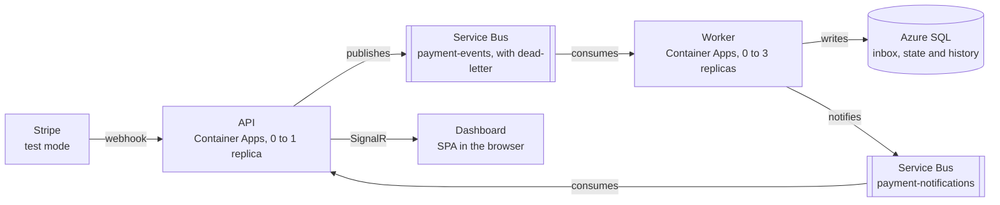

# Payment Webhook Processor (Azure) — Architecture

Version of October 11, 2026. Source of truth for the system design; the tasks are in [tasks.md](tasks.md).

## 1. Overview

The system receives Stripe webhooks in test mode, applies each event exactly once to the payment state, and shows that state live on a dashboard. The suggested repository name is `payment-webhook-processor`.

The problem is real: Stripe resends events when it doesn't get a timely response, may deliver the same event more than once, and doesn't guarantee delivery order. A naive system marks a payment as paid twice or regresses a refunded payment back to paid.

### What the project demonstrates

- **Asynchronous messaging with a reason:** the API responds to Stripe in milliseconds and the heavy work happens later, in a worker.
- **Reliability:** idempotency, tolerance to out-of-order events, bounded retry, and dead-letter with manual reprocessing.
- **Real time:** the dashboard is updated by push (SignalR), without polling.
- **Cloud operations:** containers on Azure Container Apps, queue-length scaling, managed identity, infrastructure as code, and a deploy pipeline.
- **Distributed observability:** a single trace follows the event from the API to the worker and the database.

### Out of scope

- Real billing: everything runs in Stripe test mode, with no real money.
- Multi-tenancy: there is a single Stripe account. Diopta covers that topic in the portfolio.
- User registration and access profiles: the dashboard has a single operator.
- Multi-region high availability: mentioned as an evolution, not built.

### Terms used in this document

| Term | Meaning |
| --- | --- |
| Event | A Stripe webhook, identified by `evt_...` |
| Payment | A Stripe PaymentIntent, identified by `pi_...` |
| Inbox | Table that records every received event and guarantees idempotency |
| Dead-letter (DLQ) | Service Bus subqueue for messages that exhausted their attempts |

## 2. Requirements

### Functional

| # | Requirement |
| --- | --- |
| FR1 | Receive Stripe webhooks at `POST /webhooks/stripe` and reject those without a valid signature |
| FR2 | Respond `2xx` to Stripe before any business processing |
| FR3 | Apply each event to the corresponding payment exactly once, even if it arrives repeatedly |
| FR4 | Reach the correct final state even if events arrive out of order |
| FR5 | Keep the history of each payment, including ignored events and the reason |
| FR6 | Push every state change to the dashboard in real time |
| FR7 | List dead-lettered messages and allow reprocessing them from the dashboard |
| FR8 | Provide a simulator that generates test payments, duplicates, out-of-order events and failures |

The subscribed event types are `payment_intent.created`, `payment_intent.processing`, `payment_intent.requires_action`, `payment_intent.succeeded`, `payment_intent.payment_failed`, `payment_intent.canceled` and `charge.refunded`. Stripe recommends subscribing only to what the integration uses.

### Non-functional

| # | Requirement | Target |
| --- | --- | --- |
| NFR1 | Webhook response latency | p95 under 300 ms with a warm replica |
| NFR2 | Time from webhook to screen | p95 under 3 s with a warm worker |
| NFR3 | Event loss | Zero: either the event is applied or it is in the dead-letter |
| NFR4 | Monthly cost | Within the free allowances; budget alert at US$ 5 |
| NFR5 | Secrets | No credentials in the code, the image or the repository |
| NFR6 | Traceability | One trace ID links the webhook, the message, the processing and the notification |
| NFR7 | Reproducibility | Full local environment with one `docker compose up`, and infrastructure created only by Bicep |

The latency targets apply to warm replicas. With scale to zero, the first event after an idle period pays the cold start, and that is a cost choice recorded in the decisions.

## 3. Architecture

Two containers do all the work: the API receives and publishes, the worker consumes and writes. Between them there are two Service Bus queues, one for the events and another to tell the API that a payment changed.

The API and the worker are the project's code; everything else is a managed service. The path Stripe, API, queue, worker and database is the event's path, and the path worker, notification queue, API and dashboard carries the change back to the screen. Managed identity, Key Vault and Application Insights apply to both containers.

### Components

| Component | Azure service | Responsibility |
| --- | --- | --- |
| API | Container Apps, external ingress, 0 to 1 replica | Validates the webhook signature, publishes the event, serves the read API, hosts the SignalR hub and the dashboard files |
| Worker | Container Apps, no ingress, 0 to 3 replicas | Consumes the event queue, applies idempotency and the state machine, writes to the database and publishes the notification |
| `payment-events` queue | Service Bus, Basic tier | Holds events between the API and the worker; has a built-in dead-letter |
| `payment-notifications` queue | Service Bus, Basic tier | Carries the payment-changed notice from the worker to the API; messages expire in 60 s |
| Database | Azure SQL Database, serverless free offer | Inbox, payments and history tables |
| Secrets | Key Vault | Webhook signing secret (`whsec_...`) and the dashboard admin key |
| Identity | Two managed identities (API and worker) | Passwordless access to Service Bus, the database and Key Vault |
| Telemetry | Application Insights on Log Analytics | Traces, logs and metrics from both containers |
| Images | GitHub Container Registry | Public images published by the pipeline |
| Migrations | Container Apps Job | Applies EF Core migrations on each deploy |
| Dashboard | SPA served by the API itself | Payment list, timeline, live feed and dead-letter screen |

### Why the API doesn't write to the database

On the webhook path, the API only validates and publishes. If publishing fails, it responds `500` and Stripe resends. This way ingestion doesn't depend on the database, which on the free offer pauses by itself and takes a few seconds to come back.

### Why the notification goes through a queue

The SignalR hub lives in the API, but the worker is the one that knows the payment changed. The second queue connects the two without a direct HTTP call and with the same managed-identity authentication. If nobody has the dashboard open, the API is at zero replicas and the notification simply expires.

## 4. Event flow

An event goes through ten steps between Stripe and the screen, and each step has defined failure behavior.

### Happy path

1. Stripe sends `POST /webhooks/stripe` with the `Stripe-Signature` header.
2. The API reads the raw body, without deserializing first, and validates the signature with the `whsec_...` secret and a 5-minute tolerance.
3. The API publishes to the `payment-events` queue a message whose `MessageId` is the event ID (`evt_...`) and whose body is the original JSON.
4. The API responds `200`. The synchronous work ends here.
5. The worker receives the message in peek-lock mode: it becomes invisible to other consumers but has not been removed yet.
6. The worker opens a transaction and inserts the event into the inbox table. The primary key is the event ID.
7. In the same transaction, the worker loads the payment, looks up the transition table, applies or ignores the change, and writes the history.
8. The worker commits the transaction and only then completes the message, which leaves the queue.
9. The worker publishes the notice to the `payment-notifications` queue.
10. The API consumes the notice and sends `PaymentUpdated` to the clients connected to the hub.

### What happens on each failure

| Where it fails | Effect | Who fixes it |
| --- | --- | --- |
| Invalid signature (step 2) | The API responds `400` and logs the case | Nobody: the request is discarded |
| Publishing to the queue (step 3) | The API responds `500` | Stripe resends with increasing backoff |
| Worker crashes before committing the transaction (steps 6 and 7) | The transaction is rolled back and the message lock expires | Service Bus delivers again |
| Worker crashes after committing and before completing (step 8) | The event has already been applied, but the message returns to the queue | On redelivery, the inbox insert violates the primary key and the worker just completes the message |
| Transient database error | The worker tries 3 times with increasing backoff and, if that fails, abandons the message | Service Bus delivers again, up to 5 times |
| Permanent error (unreadable event, unknown type) | The worker sends it straight to the dead-letter with the reason | An operator, via the dashboard |
| Failure publishing the notice (step 9) | The dashboard misses one live update | The dashboard reloads state on reconnect; the data in the database is correct |

The fourth case is the answer to the done-criterion question: if the worker crashes in the middle of processing, nothing is lost and nothing is applied twice.

Stripe's retries last up to three days in live mode. In the sandbox there are three attempts over a few hours, so in the test environment the dead-letter and manual resending from the Stripe dashboard matter more.

## 5. Data model

Three tables in Azure SQL support the system: the inbox guarantees idempotency, the payments table holds the current state, and the history table explains how it got there.

### `InboxEvents`

| Column | Type | Note |
| --- | --- | --- |
| `EventId` | `varchar(64)`, primary key | Stripe event ID (`evt_...`) |
| `EventType` | `varchar(64)` | For example `payment_intent.succeeded` |
| `PaymentIntentId` | `varchar(64)`, indexed | Payment the event refers to |
| `StripeCreatedAt` | `datetime2` | Informational; not used for ordering |
| `ReceivedAt` | `datetime2` | When the worker wrote it |
| `Outcome` | `tinyint` | Applied, ignored as out of order, or ignored as redundant |
| `TraceId` | `char(32)` | Links the row to the trace in Application Insights |
| `Payload` | `nvarchar(max)` | Original JSON, for auditing and reprocessing |

### `Payments`

| Column | Type | Note |
| --- | --- | --- |
| `PaymentIntentId` | `varchar(64)`, primary key | Stripe ID (`pi_...`) |
| `Status` | `tinyint` | Current state, per section 6 |
| `Amount` | `bigint` | Amount in cents; never floating point |
| `AmountRefunded` | `bigint` | Only grows: the worker keeps the highest value seen |
| `Currency` | `char(3)` | ISO code, for example `brl` |
| `LastEventId` | `varchar(64)` | Last event that changed the state |
| `CreatedAt`, `UpdatedAt` | `datetime2` | Bookkeeping |
| `RowVersion` | `rowversion` | Optimistic concurrency between worker replicas |

### `PaymentHistory`

| Column | Type | Note |
| --- | --- | --- |
| `Id` | `bigint identity`, primary key | Write order |
| `PaymentIntentId` | `varchar(64)`, indexed | Payment |
| `EventId` | `varchar(64)` | Event that produced the row |
| `FromStatus`, `ToStatus` | `tinyint` | Transition requested by the event |
| `Applied` | `bit` | False when the event was ignored |
| `Reason` | `varchar(200)` | Why it was ignored, when applicable |
| `OccurredAt` | `datetime2` | When it was processed |

### Model decisions

- **Money as integers:** amounts are stored in cents, as Stripe sends them.
- **Inbox and state in the same transaction:** this is what makes processing atomic. If the tables lived in different databases, the guarantee would be lost.
- **History of ignored events:** the dashboard timeline shows out-of-order delivery happening, which is the most convincing part of the demo.
- **Retention:** a monthly job clears the `Payload` of events older than 30 days. Stripe doesn't resend events that old, and the 32 GB of the free offer stay comfortable.
- **Dashboard reads:** the list uses keyset pagination (`UpdatedAt`, `PaymentIntentId`), without `OFFSET`.

## 6. Messaging and reliability

Delivery is "at least once" on two legs, from Stripe to the API and from the queue to the worker. Correctness comes from idempotent processing and a state machine that tolerates out-of-order delivery.

### `payment-events` queue configuration

| Parameter | Value | Reason |
| --- | --- | --- |
| Tier | Basic | Only queues are needed; no fixed monthly fee |
| Lock duration | 60 s | Headroom for processing, which takes milliseconds, and for the database to resume from pause |
| Max delivery count | 5 | After that the message goes to the dead-letter |
| Time to live | 14 days | Expired messages also go to the dead-letter |
| Concurrent calls per replica | 4 | Limits pressure on the free database |
| Auto-complete | Off | The worker completes the message only after committing the transaction |

The Basic tier offers no duplicate detection, sessions or topics. The project depends on none of the three, and that is a decision recorded in section 12.

### Idempotency

The idempotency key is the event ID, as Stripe recommends. The worker tries to insert the event into the inbox inside the transaction. If the key already exists, it rolls back the transaction, completes the message and counts the duplicate in a metric.

Stripe warns that, in rare cases, it generates two distinct events for the same fact. The inbox doesn't catch that case, because the IDs are different. The state machine does: applying "paid" to an already paid payment changes nothing and is recorded as redundant.

### Out-of-order events

Stripe doesn't guarantee delivery order and asks you not to use the `created` field for ordering. So the worker doesn't try to reorder anything. Each state has a level, and an event is only applied if it takes the payment to a higher level.

| State | Level | Event that leads to it | Final |
| --- | --- | --- | --- |
| Created | 0 | `payment_intent.created` | No |
| Requires action | 1 | `payment_intent.requires_action` | No |
| Processing | 1 | `payment_intent.processing` | No |
| Failed | 2 | `payment_intent.payment_failed` | No: a new attempt may succeed |
| Paid | 3 | `payment_intent.succeeded` | No: it can be refunded |
| Canceled | 3 | `payment_intent.canceled` | Yes |
| Partially refunded | 4 | `charge.refunded` with an amount below the total | No |
| Refunded | 5 | `charge.refunded` with the full amount | Yes |

Additional rules:

- **Event for an unknown payment:** the worker creates the payment already in the event's state. A "paid" that arrives before "created" works.
- **Event that would regress the state:** it is recorded in the history as ignored as out of order and counted in a metric. Between states of the same level, only the switch between requires action and processing is allowed.
- **Refunds:** the refunded amount never decreases. A second partial refund updates the amount and keeps the level.
- **Impossible conflict:** "paid" for a canceled payment, or the reverse, goes to the dead-letter with its own reason, because it signals a broken assumption.

### Concurrency between replicas

Two events for the same payment may be processed at the same time by different replicas. The `RowVersion` column makes the second write fail, and the worker retries processing that event from the read. Service Bus sessions would solve this with per-payment ordering, but they require the Standard tier.

### Retry and dead-letter

- **Transient error:** three attempts inside the worker, waiting 200 ms, 1 s and 5 s. If it persists, the worker abandons the message and Service Bus delivers it again.
- **Permanent error:** the worker dead-letters the message immediately, with reason and description. Retrying wouldn't help.
- **Reprocessing:** the dashboard lists the dead-letter without removing the messages. The reprocess button receives the message, publishes a copy to the main queue, and completes the original.
- **Alert:** an Azure Monitor rule sends an email when the dead-letter count goes above zero.

### Worker scaling

Container Apps scales the worker by queue length, with a KEDA rule of type `azure-servicebus`: one replica per 20 pending messages, from 0 to 3 replicas. The rule authenticates with the worker's managed identity.

### Fault injection for demos

A test payment with the `demo_fault` metadata forces a behavior in the worker: `transient` fails the first two attempts, `poison` always fails, and `slow` delays 10 s. This makes it possible to show retry, dead-letter and scaling without relying on luck. Injection only exists when the `FaultInjection:Enabled` setting is on.

## 7. Real time with SignalR

Version 1 uses ASP.NET Core's own SignalR, hosted in the API with a single replica. Azure SignalR Service only comes in with the optional horizontal scaling milestone.

### `/hubs/payments` hub contract

| Message | Direction | Content |
| --- | --- | --- |
| `PaymentUpdated` | Server to client | ID, state, amounts, currency and date of the last change |
| `EventProcessed` | Server to client | Event ID and type, outcome (applied, duplicate, ignored) and trace ID |
| `QueueStats` | Server to client | Active and dead-lettered messages, every 5 s while a client is connected |

The client doesn't send commands through the hub. Actions such as reprocessing the dead-letter use the REST API, which is easier to authenticate and test.

### Client behavior

- **Initial load:** on open, the dashboard fetches state via REST and then connects to the hub.
- **Reconnect:** uses the SignalR client's automatic reconnect and redoes the initial load when it comes back. Hub messages are not the source of truth.
- **Transport:** WebSockets, with SignalR's standard fallbacks.

### Why a single replica in version 1

With two API replicas, each client is connected to one of them, and a notice consumed by replica A doesn't reach the clients of replica B. Solving that requires a backplane and session affinity. For a dashboard with one operator, the complexity doesn't pay off.

### Optional milestone: horizontal scaling

The free tier of Azure SignalR Service allows 20 concurrent connections and 20,000 messages per day, enough for a demo. With it, clients connect to the service instead of the API, and any replica reaches every client.

The cost of this change is that the API stops scaling to zero: in the service's default mode, clients drop when no server is connected. The API would have a minimum replica, billed at the idle rate.

### Dashboard screens

| Screen | What it shows |
| --- | --- |
| Live | Feed of incoming events, with outcome and duplicate and out-of-order counters |
| Payments | Paginated table with state, amount and last update |
| Payment detail | Timeline with applied and ignored events, and a link to the trace |
| Dead-letter | Stuck messages, reason and reprocess button |

## 8. Security and identity

No Azure service is accessed with a password or a key-based connection string. The system's only secrets come from outside Azure and live in Key Vault.

### Permissions per identity

| Identity | Resource | Role |
| --- | --- | --- |
| API | `payment-events` queue | Azure Service Bus Data Sender; Data Receiver to read and reprocess the dead-letter |
| API | `payment-notifications` queue | Azure Service Bus Data Receiver |
| API | Key Vault | Key Vault Secrets User |
| API | Database | `db_datareader` |
| Worker | `payment-events` queue | Azure Service Bus Data Receiver |
| Worker | `payment-notifications` queue | Azure Service Bus Data Sender |
| Worker | Database | `db_datareader` and `db_datawriter` |
| Migration job | Database | `db_ddladmin`, plus read and write |
| Pipeline (GitHub Actions) | Resource group | Contributor, via OIDC federated credential |

Roles are assigned at the scope of each queue, not the whole namespace. The API cannot write to the database, which limits the damage if the public endpoint is compromised.

### Passwordless database

The SQL server has an Entra ID admin and password authentication turned off. Each identity becomes a contained user, created with `CREATE USER [name] FROM EXTERNAL PROVIDER`. The connection string uses `Authentication=Active Directory Default`, which works with the managed identity in the cloud and with `az login` on the local machine.

### Secrets in Key Vault

| Secret | Use |
| --- | --- |
| `stripe-webhook-secret` | Validate webhook signatures |
| `admin-api-key` | Authorize the dashboard's administrative actions |

Container Apps references the Key Vault secrets through the managed identity. Rotating the webhook secret follows what Stripe offers: for up to 24 hours both secrets are valid, so the switch doesn't break ingestion.

### Webhook endpoint

- **Signature:** validated over the raw body, with HMAC-SHA256 and a 5-minute tolerance against replay.
- **Body size:** limited to 256 KB, which is also the message cap of the Basic tier.
- **Rate limit:** the ASP.NET Core rate limiter protects the endpoint from floods of unsigned requests.
- **IP allowlist:** Stripe publishes its source IPs. It stays as optional hardening, because it requires maintaining the list.

### Dashboard

The dashboard is public and read-only, because all the data is test data. Actions that change anything require the `X-Admin-Key` header. Entra ID login would be the natural next step and is listed as an evolution.

### Secretless pipeline

GitHub Actions authenticates to Azure via OIDC, with a federated credential restricted to the repository and the `main` branch. No long-lived secret is stored in GitHub.

## 9. Observability

A single trace covers the event's entire path, and four custom metrics show what the system did with each one.

### Instrumentation

| Signal | Tool | Destination |
| --- | --- | --- |
| Traces | OpenTelemetry (ASP.NET Core, HttpClient, SqlClient, Azure SDK) | Application Insights |
| Logs | Structured Serilog, with trace ID and event ID on every line | JSON console and Application Insights |
| Metrics | `System.Diagnostics.Metrics` exported via OpenTelemetry | Application Insights |

The API and the worker use the Azure Monitor exporter for OpenTelemetry. The Service Bus SDK propagates trace context in the message properties, so the worker's span shows up linked to the API's span with no extra code.

### Spans of an event

1. `POST /webhooks/stripe` in the API.
2. Send to `payment-events`.
3. Message processing in the worker.
4. SQL transaction.
5. Send to `payment-notifications`.
6. Notice consumption and hub send in the API.

### Custom metrics

| Metric | Type | Question it answers |
| --- | --- | --- |
| `events.received` | Counter, by type | How much is coming in? |
| `events.duplicate` | Counter | How many repeated deliveries did idempotency absorb? |
| `events.out_of_order` | Counter | How many events were ignored as out of order? |
| `events.dead_lettered` | Counter, by reason | What could the system not process? |
| `event.processing.duration` | Histogram | How long from receipt to commit? |

### Alerts

- **Dead-letter above zero:** Service Bus metric, with email.
- **Webhook failures:** more than 5 `5xx` responses in 5 minutes.

### Volume control

The first 5 GB of ingestion per month are free. The workspace has a 0.2 GB daily cap as protection, and health checks are excluded from traces.

### Health checks

| Endpoint | Checks | Used by |
| --- | --- | --- |
| `/health/live` | That the process responds | Container Apps liveness probe |
| `/health/ready` | Connection to Service Bus | Readiness probe |

The database is deliberately left out of the API's readiness check: it may be paused, and the API must keep receiving webhooks.

## 10. Infrastructure, cost and deploy

All infrastructure is created by Bicep and fits within the free allowances, except for Service Bus and Key Vault, which charge cents per operation.

### Resources and cost

| Resource | Tier | Allowance or billing |
| --- | --- | --- |
| Container Apps (API, worker, job) | Consumption | 180,000 vCPU-seconds, 360,000 GiB-seconds and 2 million requests free per month; no charge at zero replicas ([pricing](https://azure.microsoft.com/en-us/pricing/details/container-apps/)) |
| Service Bus | Basic | Billed per million operations, no fixed fee ([pricing](https://azure.microsoft.com/en-us/pricing/details/service-bus/)) |
| Azure SQL Database | Free offer, serverless | 100,000 vCore-seconds and 32 GB per month, for the life of the subscription ([documentation](https://learn.microsoft.com/en-us/azure/azure-sql/database/free-offer)) |
| Application Insights and Log Analytics | Pay as you go | First 5 GB of ingestion per month free |
| Key Vault | Standard | Billed per operation; cents at this volume |
| GitHub Container Registry | Public repository | Free |
| Azure SignalR Service (optional milestone) | Free | 20 concurrent connections and 20,000 messages per day ([pricing](https://azure.microsoft.com/en-us/pricing/details/signalr-service/)) |

New Azure accounts get US$ 200 of credit for 30 days, which covers any overrun during the build.

### Cost safeguards

- **Budget:** create a US$ 5 budget in Cost Management, with alerts at 50% and 100%, before the first deploy.
- **Free database:** configure it to pause when the monthly allowance runs out, instead of billing the overage.
- **Database region:** the region of the first free database applies to the others in the subscription. Confirm the offer is available before choosing.
- **Suggested region:** East US 2, for price, or North Europe, which is in Ireland. All resources in the same region.
- **Service Bus Standard:** don't create it, not even to test, because it has a fixed hourly fee.

### Container sizing

| Container | CPU | Memory | Replicas | Scale rule |
| --- | --- | --- | --- | --- |
| API | 0.25 vCPU | 0.5 GiB | 0 to 1 | HTTP, 50 concurrent requests |
| Worker | 0.25 vCPU | 0.5 GiB | 0 to 3 | Queue length, 20 messages per replica |
| Migration job | 0.25 vCPU | 0.5 GiB | On demand | Triggered by the pipeline |

### Bicep modules

| File | Creates |
| --- | --- |
| `main.bicep` | Orchestrates the modules and receives the environment parameters |
| `identity.bicep` | The managed identities |
| `servicebus.bicep` | Namespace, both queues and the role assignments |
| `sql.bicep` | Server, free database and Entra ID admin |
| `keyvault.bicep` | Vault and role assignments |
| `monitoring.bicep` | Log Analytics, Application Insights and alerts |
| `containerapps.bicep` | Environment, API, worker and migration job |

### Pipeline

| Workflow | Trigger | Steps |
| --- | --- | --- |
| `ci.yml` | Pull request | Build, unit tests, integration tests with Testcontainers, `bicep build` and `what-if` |
| `deploy.yml` | Push to `main` | Build the images, push to GHCR tagged with the commit, deploy the Bicep, run the migration job, update the revisions |

Each deploy creates a new Container Apps revision tagged with the commit. Rolling back means reactivating the previous revision.

### Local environment

One `docker compose up` starts SQL Server, the official Service Bus emulator, the API and the worker. The Stripe CLI forwards test webhooks to the machine with `stripe listen --forward-to localhost:8080/webhooks/stripe`. Locally, authentication uses the emulator's connection strings, and switching to managed identity is configuration only.

The API runs as `Development` locally, which exposes the OpenAPI document at `/openapi/v1.json` and Swagger UI at `/swagger`. Neither is mapped outside `Development`, so the public endpoint in the cloud doesn't publish the API description.

The emulator caps message time to live at 1 hour, so locally `payment-events` uses 1 hour instead of the 14 days in section 6; the cloud queue keeps 14 days. The emulator is published on host port 5673 instead of 5672 so it doesn't clash with a locally installed RabbitMQ; containers in the compose network still use `servicebus:5672`.

## 11. Solution structure and tests

The solution follows a lean Clean Architecture: the domain knows nothing about Azure, and the two executables share application and infrastructure.

### Projects

| Project | Contents |
| --- | --- |
| `src/Payments.Domain` | `Payment`, `PaymentStatus`, transition table and transition result; no dependencies |
| `src/Payments.Application` | `ProcessStripeEvent` use case and the repository, inbox and notification ports |
| `src/Payments.Infrastructure` | EF Core, Service Bus, Stripe signature validation and OpenTelemetry configuration |
| `src/Payments.Api` | Controllers, hub, notification consumer and dashboard files |
| `src/Payments.Worker` | `BackgroundService` with the `ServiceBusProcessor` |
| `src/Payments.Migrator` | Executable that applies the migrations |
| `web/` | Dashboard code |
| `tools/Simulator` | Generates test payments, duplicates and out-of-order events |
| `infra/` | Bicep |
| `docs/adr/` | Architecture decisions, in English |

There is no MediatR: there is a single use case, and recent versions of the library have a commercial license.

### Test strategy

| Level | Tool | What it covers |
| --- | --- | --- |
| Unit, domain | xUnit | Every combination of current state and event in the transition table |
| Unit, application | xUnit with in-memory test doubles | Duplicate, unknown payment, concurrency conflict and partial refund |
| Property | xUnit with generated permutations | Any order and any repetition of a valid event sequence leads to the same final state |
| Integration | Testcontainers with SQL Server and the Service Bus emulator | A duplicate delivery writes one row; a poison message reaches the dead-letter after 5 deliveries; a crash after commit doesn't duplicate |
| API | `WebApplicationFactory` | An invalid signature returns `400`; a valid signature returns `200` and publishes a message |
| Contract | JSON files of real Stripe events in `tests/fixtures` | The parser accepts the format Stripe actually sends |

The property test is the most valuable in the project. It proves the central claim of the architecture: the order and repetition of deliveries don't change the result.

### Simulator

| Mode | What it does |
| --- | --- |
| `pay` | Creates payments in Stripe test mode with test cards that approve, decline or require authentication |
| `refund` | Refunds existing payments, fully or partially |
| `replay` | Resends already received events, signed with the test secret, doubled and out of order |
| `flood` | Creates a large batch of payments to trigger worker scaling |

## 12. Architecture decisions

Ten decisions define the project. Each becomes a short ADR in `docs/adr/`, in English, with context, decision, alternatives and consequences.

| # | Decision | Rejected alternatives | Reason |
| --- | --- | --- | --- |
| 1 | Queue between the API and the worker | Processing inside the webhook request | Stripe requires a fast response and recommends a queue; spikes don't take down the endpoint; ingestion doesn't depend on the database |
| 2 | Service Bus instead of Storage Queues | Storage Queues, Event Grid | Native dead-letter, peek-lock and delivery count; it's the messaging service the study plan wants to cover |
| 3 | Basic tier with idempotency in the application | Standard with duplicate detection and sessions | No fixed fee; broker detection has a time window and doesn't cover Stripe resending days later; the inbox covers both legs |
| 4 | No outbox on ingestion | Write the event to the database and publish via a relay | Stripe is already the durable source and resends; an outbox here would duplicate that guarantee |
| 5 | Tolerate out-of-order delivery with state levels | Sessions for ordering; fetching the current state from the Stripe API on every event | Stripe doesn't guarantee order at the source, so ordering in the queue doesn't solve it; calling the API couples the worker to Stripe's availability and rate limits |
| 6 | Snapshot events | Thin events, which Stripe recommends for new integrations | The snapshot carries the full object, avoids an extra call and allows file-based tests; out-of-order delivery is already handled by decision 5 |
| 7 | Container Apps | App Service, AKS, Functions | Scales to zero and by queue length without operating a cluster; the same container runs locally and in the cloud |
| 8 | Azure SQL | Cosmos DB, PostgreSQL | A transaction across inbox and state is the core of the design; permanent free offer; builds on SQL Server experience |
| 9 | SignalR in the API itself with one replica | Azure SignalR Service from the start | Keeps the API scaling to zero and avoids a backplane for a single operator |
| 10 | Managed identity and images on GHCR | Connection strings; Azure Container Registry | No service secret to leak or rotate; ACR has a fixed monthly cost |

### What I would do differently in production

This list feeds the section of the same name in the README:

- **Service Bus Standard or Premium:** per-payment sessions would eliminate concurrency conflicts, and topics would allow more than one consumer per event.
- **Minimum replica for the API:** an always-warm replica would take cold start off the webhook path.
- **Private networking:** database, Service Bus and Key Vault behind private endpoints, with Container Apps in a VNet.
- **Two regions:** a second region with database replication, and the webhook endpoint behind Front Door.
- **Real login:** Entra ID on the dashboard, with read and operator roles.

## 13. Build roadmap

There are eight milestones, M0 to M7, each deliverable on its own. The study plan's done criterion is reached at milestone 5; milestone 6 wraps up the documentation and milestone 7 is optional.

| Milestone | Deliverable | Done when | Chapter of your Azure notes |
| --- | --- | --- | --- |
| M0. Skeleton | Solution, `docker compose` with SQL Server and the emulator, CI with build and tests | `docker compose up` starts everything and CI passes on a pull request | CI/CD |
| M1. Ingestion | Webhook endpoint, signature validation, publishing to the queue | `stripe trigger payment_intent.succeeded` produces a message on the local queue | Messaging |
| M2. Processing | Worker, inbox, state machine, history, and unit and property tests | The simulator's `replay` mode doesn't change the final state of any payment | Messaging |
| M3. Failures | Retry, dead-letter, reprocessing and fault injection, with integration tests | A `poison` message reaches the dead-letter and comes back through the reprocess endpoint | Messaging |
| M4. Cloud | Bicep, identities, Key Vault, deploy through the pipeline, and queue-based scaling | A Stripe webhook reaches the public endpoint and the worker scales up from zero on its own | Deploy and Hosting, Health Checks, CI/CD |
| M5. Dashboard and telemetry | SignalR, screens, OpenTelemetry, metrics and alerts | A test payment shows up on screen in under 3 s and the trace shows the six spans | Monitoring, plus the official SignalR docs |
| M6. Documentation | README in English with diagram, ADRs and a "what I'd do differently" section | You explain the system in 3 minutes without looking anything up | None |
| M7. Horizontal scaling (optional) | Azure SignalR Service and two API replicas | Two browsers on different replicas receive the same update | Official docs |

The order puts the cloud after the logic on purpose. From M0 to M3 everything runs on the local machine, at no cost and with a fast feedback loop, and M4 becomes a configuration change instead of blind debugging.

## 14. Risks, open questions and interview questions

Five points need to be validated early, because a surprise in any of them changes the design.

### Risks to validate

| Risk | When to validate | Plan B |
| --- | --- | --- |
| An open SignalR connection may not keep the API replica from scaling to zero | M5 | Minimum replica of 1 during demos |
| The role the KEDA rule needs to read the queue length may be broader than Data Receiver | M4 | Assign the role indicated in the KEDA docs to that identity only |
| The API's cold start may exceed Stripe's response timeout | M4 | Stripe resends; if it becomes a nuisance, minimum replica of 1 |
| A paused database delays the first event by tens of seconds | M4 | The 60 s lock and the retry cover it; if not enough, increase the lock duration |
| The Service Bus emulator may behave differently from the cloud in delivery counting | M3 | Also run the dead-letter tests against the real namespace in the pipeline |

### Open questions

- [ ] Dashboard framework: Angular or React. Suggestion: Angular, since Diopta already shows React.
- [ ] Final name of the repository and the project.
- [ ] Region: East US 2 or North Europe.
- [ ] Keep the environment running once done, or bring it up only for demos, with a short video in the README.

### Questions the project prepares you to answer

1. What happens if the worker crashes in the middle of processing?
2. How do you guarantee an event isn't applied twice?
3. Why didn't you use Service Bus duplicate detection?
4. What do you do when events arrive out of order?
5. Why a queue, if the volume is low?
6. Why Container Apps and not AKS or App Service?
7. How do the services authenticate with each other? Where are the secrets?
8. How do you find out why a specific event wasn't processed?
9. What changes if the API needs two replicas?
10. How much does it cost to keep this running, and what gets expensive first if volume grows?
11. What would you do differently in production?

Each question is answered in a section of this document. Rehearsing all eleven out loud, in English, covers the plan's extra English session for a few weeks.

## Sources

- [Stripe: receive events at your webhook endpoint](https://docs.stripe.com/webhooks) (retries, ordering, duplicates, signature)
- [Azure Service Bus: pricing and tier comparison](https://azure.microsoft.com/en-us/pricing/details/service-bus/)
- [Azure Container Apps: pricing and monthly free allowance](https://azure.microsoft.com/en-us/pricing/details/container-apps/)
- [Azure SQL Database: free offer](https://learn.microsoft.com/en-us/azure/azure-sql/database/free-offer)
- [Azure SignalR Service: pricing and free tier limits](https://azure.microsoft.com/en-us/pricing/details/signalr-service/)

Prices and limits were checked on the date of this document and change often. Check them again before creating the resources.
