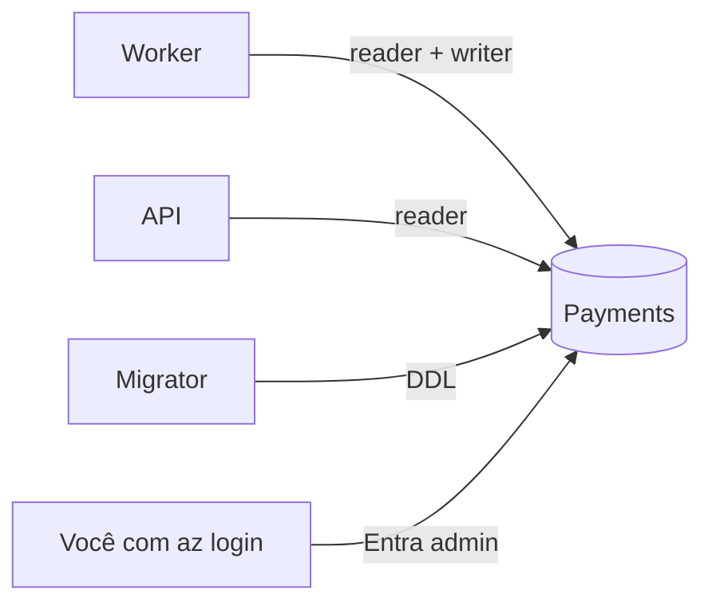

# Azure SQL Database (oferta gratuita)

## 1. O que é

O SQL Server como serviço: o Azure cuida de servidor, atualizações e backup; nós cuidamos das tabelas. A variante **serverless** liga e desliga sozinha: sem uso, pausa e não consome. Analogia: uma loja que apaga as luzes quando não há cliente e reabre na primeira batida na porta (a primeira consulta depois da pausa demora alguns segundos).

## 2. Equivalente local

O SQL Server do `docker compose`, com autenticação SQL e o usuário `sa` (senha em `.env`). O esquema vem das mesmas migrations, aplicadas pelo migrator. Na nuvem, não há senha: só Entra ID.

## 3. Por que ele e não a alternativa

Decisão 8: uma transação que cobre inbox, estado e histórico é o centro do desenho, e Cosmos DB ou PostgreSQL não são tão naturais para isso nem aproveitam a experiência prévia com SQL Server. A oferta gratuita é permanente (seção 10).

## 4. Camada escolhida

| Item | Valor |
| --- | --- |
| SKU | `GP_S_Gen5`, 2 vCores no máximo, 0,5 no mínimo, serverless |
| Gratuito por mês | 100.000 vCore-segundos e 32 GB |
| Quando acaba | `freeLimitExhaustionBehavior: AutoPause`: o banco **pausa até o mês seguinte** em vez de cobrar |
| Auto-pausa por inatividade | 60 minutos |
| Backup | Redundância `Local` (a mais barata) |
| Autenticação | Só Entra ID (`azureADOnlyAuthentication: true`) |
| Região | Central US (East US 2 e East US recusaram o servidor nesta assinatura) |

A alternativa `BillOverUsage` continuaria funcionando e cobraria o excedente. Foi descartada para o custo nunca passar do orçamento de US$ 5.

## 5. Como entra no nosso sistema



Exemplo: depois de uma hora sem eventos o banco pausa. O próximo evento chega, o worker tenta gravar e a conexão espera o banco retomar (46 a 55 s medidos). Retomar da pausa parece uma falha de conexão passageira, então o worker repete o erro transitório esperando 1 s, 5 s e 15 s (seção 6). Quem segura a mensagem durante a retomada são essas esperas, não o lock de 60 s: se as 4 tentativas falham, o *abandon* libera o lock na hora e a próxima entrega começa em seguida. Com 5 entregas, são 105 s só de espera. A tarefa 4.10 e o [ADR 0011](../adr/0011-transient-retry-window.md) têm a medição.

**Usuários contidos.** O banco não conhece as identidades do Azure até criarmos usuários dentro dele. `infra/sql/create-users.sql` faz `CREATE USER [id-...] WITH SID = <clientId em binário>, TYPE = E`. Usamos o SID em vez de `FROM EXTERNAL PROVIDER` porque o segundo obriga o servidor a consultar o Entra ID, o que exige uma permissão de leitura do diretório no tenant; com o SID o banco não chama o Entra ID.

## 6. Glossário

| Termo | Significado |
| --- | --- |
| Servidor lógico | Contêiner de bancos, firewall e administrador; não é uma VM |
| Serverless | Cobra por uso e pode pausar |
| vCore-segundo | Unidade de consumo de CPU |
| Entra ID admin | Quem administra o servidor sem senha |
| Usuário contido | Usuário que existe dentro do banco, sem login no servidor |
| SID | Identificador do usuário; para identidades vira o `clientId` em bytes |
| Regra `0.0.0.0` | "Permitir serviços do Azure"; não abre para a internet toda |

## 7. O que pode dar errado e quanto custa errar

- **Cobrança:** dentro da oferta, zero. O risco é criar um segundo banco gratuito: a oferta é por assinatura, e a região do primeiro vale para os seguintes (seção 10).
- **`RegionDoesNotAllowProvisioning`:** a assinatura só cria servidores em regiões `Available` na API de capabilities. Foi o que obrigou a mudar para Central US.
- **Firewall:** o IP de quem administra é pessoal e muda; entra à mão com `az sql server firewall-rule create`.
- **SID errado:** o usuário existe mas o token da identidade não bate e o login falha. O script converte o `clientId` (GUID) em bytes com `ToByteArray`, que usa a ordem de bytes do SQL Server.
- **Desfazer:** apagar o banco apaga os dados; apagar o servidor apaga os bancos.

## 8. Como conferir

```bash
az sql db show -g rg-payment-webhooks -s <servidor> -n Payments --query "{free:useFreeLimit,exhaust:freeLimitExhaustionBehavior,pause:autoPauseDelay,sku:sku.name}"
az sql server show -g rg-payment-webhooks -n <servidor> --query "administrators"
sqlcmd -S <servidor>.database.windows.net -d Payments --authentication-method ActiveDirectoryAzCli -Q "SELECT name, type_desc FROM sys.database_principals WHERE type = 'E'"
```

No portal: o banco → **Overview** (estado Online/Paused) e **Compute + storage** (oferta gratuita e o que fazer ao esgotar).
