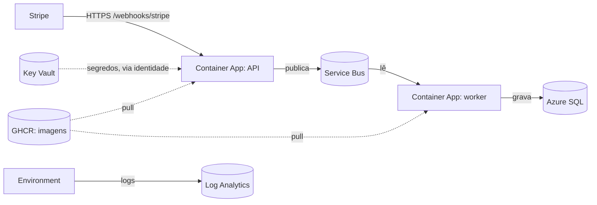

# Azure Container Apps

## 1. O que é

Um serviço que roda containers sem você administrar servidores. Você entrega a imagem Docker e diz quanta CPU e memória ela usa; a plataforma coloca para rodar, dá um endereço HTTPS e liga e desliga réplicas conforme a carga. Analogia: um estacionamento com manobrista. Você deixa o carro (a imagem), o manobrista escolhe a vaga, e quando o carro não é usado ele sai do pátio e você não paga a vaga.

Há três peças, que a tarefa 4.5 cria:

| Peça | O que é | No nosso sistema |
| --- | --- | --- |
| **Environment** | A fronteira em que os apps rodam juntos: rede e destino dos logs | `cae-payment-webhooks` |
| **Container App** | Um serviço que fica no ar (com ou sem endereço público) e escala | A API (com endereço) e o worker (sem) |
| **Job** | Um container que roda até terminar e sai | O migrator, disparado à mão (e pelo pipeline na 4.8) |

## 2. Equivalente local

O `docker-compose.yml`: o serviço `api` é o app com endereço, `worker` é o app sem endereço e `migrator` é o job (`restart: "no"`, roda e sai). A diferença é quem decide quantas réplicas existem: no compose é sempre uma; na nuvem a plataforma muda isso (tarefa 4.7).

## 3. Por que ele e não a alternativa

Decisão da seção 12 e restrição de custo da seção 10: com a camada Consumption, a cota gratuita mensal é de 180.000 vCPU-segundos, 360.000 GiB-segundos e 2 milhões de requisições, e **réplica parada não cobra**. As alternativas descartadas: App Service (cobra o plano mesmo parado) e AKS (administrar o cluster é o oposto do que o projeto quer mostrar).

## 4. Camada escolhida

| Item | Valor |
| --- | --- |
| Plano | **Consumption** (pagamento por uso), não Dedicated |
| Tamanho | 0,25 vCPU e 0,5 GiB por réplica, em todos os containers (seção 10) |
| Réplicas | API 0 a 1; worker 0 a 3; job sob demanda |
| Cota gratuita | 180.000 vCPU-s, 360.000 GiB-s e 2 milhões de requisições por mês |
| Quando acaba | Passa a cobrar pelo excedente, a preços de centavos por hora de réplica. Com mínimo zero e tráfego de teste, não chegamos perto |
| O que não tem | Garantia de início instantâneo: a primeira requisição depois de zerar espera a réplica subir (*cold start*, risco da seção 14) |

## 5. Como entra no nosso sistema



Exemplo concreto, a API: a plataforma baixa `ghcr.io/milsucruz/payment-webhook-processor-api:<tag>` (pública, sem credencial), lê `stripe-webhook-secret` e `admin-api-key` do Key Vault com a identidade da API e injeta os valores nas variáveis `Stripe__WebhookSecret` e `Admin__ApiKey`; o ASP.NET Core lê essas variáveis como lê o `.env` no compose. Se o container não tem tráfego, a réplica some; a próxima requisição à URL pública a recria.

**Segredo por referência.** No `secrets` do app, cada segredo tem `keyVaultUrl` e `identity`. O valor nunca passa pelo Bicep, só a URL. Se a identidade não tem o papel Secrets User, o app **não sobe**.

**Identidade.** Cada app e o job têm uma identidade gerenciada atribuída pelo usuário (criadas na 4.2). A mesma identidade lê o Key Vault; o acesso a Service Bus e SQL chega na 4.6. Ver [managed-identity-rbac.md](managed-identity-rbac.md).

**Logs.** O environment manda o stdout dos containers para o workspace do Log Analytics ([log-analytics-application-insights.md](log-analytics-application-insights.md)), onde vale o teto de 0,2 GB por dia.

## 6. Glossário

| Termo | Significado |
| --- | --- |
| Environment | O agrupamento de apps e jobs com rede e logs em comum |
| Container App | Serviço de longa duração |
| Job | Container que roda e termina; gatilho manual, agendado ou por evento |
| Revision | Uma versão imutável do app; mudar imagem ou configuração cria outra |
| Ingress | A porta de entrada HTTP; `external` dá URL pública com HTTPS |
| Replica | Uma cópia em execução |
| Scale to zero | Mínimo de réplicas igual a 0: sem tráfego, nada roda e nada cobra |
| Consumption | Plano que cobra por uso |
| Cold start | A espera de uma requisição que chega com zero réplicas |
| `secretRef` | Variável de ambiente cujo valor vem de um segredo do app |

## 7. O que pode dar errado e quanto custa errar

- **Imagem privada ou inexistente:** o app falha ao criar com erro de pull. Custo: nenhum, só tempo. As imagens do GHCR precisam estar públicas (seção 10).
- **Sem papel no Key Vault:** a revisão fica em falha. Conferir o role assignment antes do deploy.
- **Mínimo de réplicas acima de zero:** passa a gastar a cota o mês inteiro. Mantemos 0.
- **Worker com falha de configuração:** com mínimo maior que zero entraria em *crash loop*. Por isso fica em zero até as tarefas 4.6 e 4.7.
- **Apagar o environment:** apaga os apps e jobs dentro dele; recriar é rodar o Bicep de novo.
- **A API é pública:** qualquer um chega ao `/webhooks/stripe`; a defesa é a assinatura e o limitador de taxa (seção 8).

## 8. Como conferir

```bash
az containerapp env show -g rg-payment-webhooks -n cae-payment-webhooks --query "{state:properties.provisioningState,domain:properties.defaultDomain}"
az containerapp show -g rg-payment-webhooks -n ca-payment-webhooks-api --query "{fqdn:properties.configuration.ingress.fqdn,min:properties.template.scale.minReplicas,max:properties.template.scale.maxReplicas,image:properties.template.containers[0].image}"
az containerapp revision list -g rg-payment-webhooks -n ca-payment-webhooks-api -o table
az containerapp job show -g rg-payment-webhooks -n caj-payment-webhooks-migrator --query "properties.configuration.triggerType"
az containerapp logs show -g rg-payment-webhooks -n ca-payment-webhooks-api --tail 50
```

No portal: o recurso `ca-payment-webhooks-api` → **Revisions and replicas** e **Log stream**.
