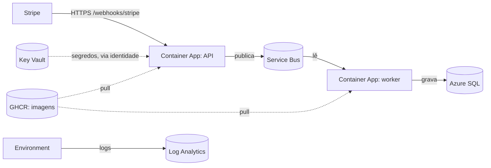
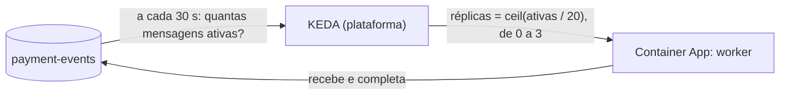

# Azure Container Apps

## 1. O que é

Um serviço que roda containers sem você administrar servidores. Você entrega a imagem Docker e diz quanta CPU e memória ela usa; a plataforma coloca para rodar, dá um endereço HTTPS e liga e desliga réplicas conforme a carga. Analogia: um estacionamento com manobrista. Você deixa o carro (a imagem), o manobrista escolhe a vaga, e quando o carro não é usado ele sai do pátio e você não paga a vaga.

Há três peças, que a tarefa 4.5 cria:

| Peça | O que é | No nosso sistema |
| --- | --- | --- |
| **Environment** | A fronteira em que os apps rodam juntos: rede e destino dos logs | `cae-payment-webhooks` |
| **Container App** | Um serviço que fica no ar (com ou sem endereço público) e escala | A API (com endereço) e o worker (sem) |
| **Job** | Um container que roda até terminar e sai | O migrator, disparado à mão (e pelo pipeline na 4.8) |

## 2. Equivalente local

O `docker-compose.yml`: o serviço `api` é o app com endereço, `worker` é o app sem endereço e `migrator` é o job (`restart: "no"`, roda e sai). A diferença é quem decide quantas réplicas existem: no compose é sempre uma; na nuvem a plataforma muda isso (tarefa 4.7). O compose também não tem probes: o `/health/live` e o `/health/ready` respondem localmente (o `ready` faz o *peek* no emulador), mas só o Container Apps os chama.

## 3. Por que ele e não a alternativa

Decisão da seção 12 e restrição de custo da seção 10: com a camada Consumption, a cota gratuita mensal é de 180.000 vCPU-segundos, 360.000 GiB-segundos e 2 milhões de requisições, e **réplica parada não cobra**. As alternativas descartadas: App Service (cobra o plano mesmo parado) e AKS (administrar o cluster é o oposto do que o projeto quer mostrar).

## 4. Camada escolhida

| Item | Valor |
| --- | --- |
| Plano | **Consumption** (pagamento por uso), não Dedicated |
| Tamanho | 0,25 vCPU e 0,5 GiB por réplica, em todos os containers (seção 10) |
| Réplicas | API 0 a 1 (regra HTTP padrão); worker 0 a 3, pela regra de fila da tarefa 4.7; job sob demanda |
| Cota gratuita | 180.000 vCPU-s, 360.000 GiB-s e 2 milhões de requisições por mês |
| Quando acaba | Passa a cobrar pelo excedente, a preços de centavos por hora de réplica. Com mínimo zero e tráfego de teste, não chegamos perto |
| O que não tem | Garantia de início instantâneo: a primeira requisição depois de zerar espera a réplica subir (*cold start*, risco da seção 14) |

## 5. Como entra no nosso sistema



Exemplo concreto, a API: a plataforma baixa `ghcr.io/milsucruz/payment-webhook-processor-api:<tag>` (pública, sem credencial), lê `stripe-webhook-secret` e `admin-api-key` do Key Vault com a identidade da API e injeta os valores nas variáveis `Stripe__WebhookSecret` e `Admin__ApiKey`; o ASP.NET Core lê essas variáveis como lê o `.env` no compose. Se o container não tem tráfego, a réplica some; a próxima requisição à URL pública a recria.

**Segredo por referência.** No `secrets` do app, cada segredo tem `keyVaultUrl` e `identity`. O valor nunca passa pelo Bicep, só a URL. Se a identidade não tem o papel Secrets User, o app **não sobe**.

**Identidade.** Cada app e o job têm uma identidade gerenciada atribuída pelo usuário (criadas na 4.2). A mesma identidade lê o Key Vault; o acesso a Service Bus e SQL chega na 4.6. Ver [managed-identity-rbac.md](managed-identity-rbac.md).

**Escala do worker (tarefa 4.7).** O worker não tem endereço, então nenhuma requisição o acorda. Quem decide é uma **regra de escala** do tipo `azure-servicebus`, executada pelo **KEDA**, o componente de autoescala que o Container Apps roda por baixo:



Exemplo concreto, medido na tarefa 4.7: o `flood` mandou 100 pagamentos com `demo_fault=slow` (cada entrega espera 10 s). O KEDA leu 96 mensagens, calculou `ceil(96/20) = 5` e parou no máximo, 3 réplicas. Com 3 × 4 chamadas concorrentes ÷ 10 s, a fila esvaziou em cerca de 1,5 min. A fila ficou em zero, e 300 s depois (o *cooldown*) o worker voltou a zero.

A regra se autentica com a **identidade do worker** (`identity` na regra, com o *resource ID* da identidade), não com connection string. O KEDA pede acesso *Manage* quando usa connection string, mas com a identidade o **Data Receiver** que o worker já tem na fila bastou (risco da seção 14, validado). A propriedade `identity` da regra não existe na versão de API `2024-03-01` do `Microsoft.App` (o Bicep avisa `BCP037`); a `2025-01-01`, que o projeto usa desde a 4.7, a tem.

**Probes (tarefa 4.7).** A plataforma pergunta à API, por HTTP na porta 8080, se ela está viva e se está pronta:

| Probe | Caminho | O que a plataforma faz se falhar 3 vezes |
| --- | --- | --- |
| *Liveness* (a cada 10 s, timeout 3 s) | `/health/live`, que não testa nada além do processo | Reinicia o container |
| *Readiness* (a cada 5 s, timeout 10 s) | `/health/ready`, que faz um *peek* em `payment-events` | Tira a réplica do tráfego até voltar a responder |

Exemplo concreto: se o Service Bus cair, o `ready` falha e o ingress para de mandar webhooks à réplica, mas o `live` continua `200`, então a API não reinicia em loop. Quando a API sobe do zero, a requisição espera a *readiness*, que já abre a conexão AMQP; o timeout de 10 s cobre o pior caso do *peek* com as tentativas do cliente (cerca de 8 s). O preço: as probes rodam uma depois da outra, então numa queda a réplica sai do tráfego em cerca de 25 s (3 falhas de cerca de 8 s), não em 15 s (3 × 5 s). O worker não tem probes: sem servidor HTTP não há o que chamar, e se o processo cair o container reinicia sozinho.

**Logs.** O environment manda o stdout dos containers para o workspace do Log Analytics ([log-analytics-application-insights.md](log-analytics-application-insights.md)), onde vale o teto de 0,2 GB por dia.

## 6. Glossário

| Termo | Significado |
| --- | --- |
| Environment | O agrupamento de apps e jobs com rede e logs em comum |
| Container App | Serviço de longa duração |
| Job | Container que roda e termina; gatilho manual, agendado ou por evento |
| Revision | Uma versão imutável do app; mudar imagem ou configuração cria outra |
| Ingress | A porta de entrada HTTP; `external` dá URL pública com HTTPS |
| `X-Forwarded-For` | Cabeçalho em que o ingress acrescenta, no fim, o IP de quem chamou; para o container, a conexão vem do proxy. A API lê só o último valor (tarefa 4.9) |
| Replica | Uma cópia em execução |
| Scale to zero | Mínimo de réplicas igual a 0: sem tráfego, nada roda e nada cobra |
| Consumption | Plano que cobra por uso |
| Cold start | A espera de uma requisição que chega com zero réplicas |
| `secretRef` | Variável de ambiente cujo valor vem de um segredo do app |
| KEDA | *Kubernetes Event-driven Autoscaling*: o componente que lê a fonte (a fila) e decide o número de réplicas |
| Scale rule | Regra que diz ao KEDA o que medir e o alvo por réplica (`messageCount: 20`) |
| Polling interval | De quanto em quanto tempo o KEDA lê a fila: 30 s |
| Cooldown period | Quanto tempo o KEDA espera, depois da última mensagem, para ir de 1 réplica a 0: 300 s |
| Activation | A passagem de 0 para 1 réplica, assim que há ao menos 1 mensagem ativa |
| Liveness probe | Pergunta "o processo está vivo?"; falhou, reinicia |
| Readiness probe | Pergunta "pode receber tráfego?"; falhou, sai do balanceamento |
| Startup probe | Pergunta "terminou de subir?"; não definimos, a plataforma usa a padrão (TCP) |

## 7. O que pode dar errado e quanto custa errar

- **Imagem privada ou inexistente:** o app falha ao criar com erro de pull. Custo: nenhum, só tempo. As imagens do GHCR precisam estar públicas (seção 10).
- **Sem papel no Key Vault:** a revisão fica em falha. Conferir o role assignment antes do deploy.
- **Mínimo de réplicas acima de zero:** passa a gastar a cota o mês inteiro. Mantemos 0.
- **Worker com falha de configuração:** com mínimo maior que zero entraria em *crash loop*. Mesmo com mínimo zero, a regra acorda o worker sempre que há mensagem, então um worker quebrado fica subindo e caindo enquanto a fila não esvaziar.
- **Regra de escala sem identidade ou com versão de API antiga:** o worker não acorda e as mensagens ficam paradas na fila (até expirar em 14 dias e ir para a dead-letter). Sem custo, mas sem processamento. Conferir com `az containerapp show` que `rules` aparece.
- **Mensagens paradas mantêm o worker acordado:** a regra conta mensagens ativas; enquanto houver uma, o mínimo é 1 réplica, o tempo todo. A dead-letter não conta, então uma mensagem envenenada não segura o worker de pé.
- **Liveness testando dependência externa:** se o `/health/live` testasse o Service Bus, uma queda dele reiniciaria a API em loop. Por isso só o `ready` testa.
- **Cold start:** a primeira requisição com a API em zero esperou 27,7 s na tarefa 4.7, cerca de 19 s da plataforma (agendar a réplica e baixar a imagem). Na 4.9, com entregas reais, o Stripe não esperou: de dois eventos com a API em zero, um entrou e o outro ficou para o reenvio do Stripe (cerca de 1 h depois). O remédio, mínimo de 1 réplica, custaria cerca de US$ 4 por mês depois da cota gratuita; ficou em zero, e antes de uma demo um `curl .../health/live` aquece a API.
- **Apagar o environment:** apaga os apps e jobs dentro dele; recriar é rodar o Bicep de novo.
- **A API é pública:** qualquer um chega ao `/webhooks/stripe`; a defesa é a assinatura e o limitador de taxa (seção 8).

## 8. Como conferir

```bash
az containerapp env show -g rg-payment-webhooks -n cae-payment-webhooks --query "{state:properties.provisioningState,domain:properties.defaultDomain}"
az containerapp show -g rg-payment-webhooks -n ca-payment-webhooks-api --query "{fqdn:properties.configuration.ingress.fqdn,min:properties.template.scale.minReplicas,max:properties.template.scale.maxReplicas,image:properties.template.containers[0].image}"
az containerapp revision list -g rg-payment-webhooks -n ca-payment-webhooks-api -o table
az containerapp job show -g rg-payment-webhooks -n caj-payment-webhooks-migrator --query "properties.configuration.triggerType"
az containerapp logs show -g rg-payment-webhooks -n ca-payment-webhooks-api --tail 50
az containerapp show -g rg-payment-webhooks -n ca-payment-webhooks-worker --query "properties.template.scale"                 # regra de escala
az containerapp show -g rg-payment-webhooks -n ca-payment-webhooks-api --query "properties.template.containers[0].probes"     # probes
az containerapp replica list -g rg-payment-webhooks -n ca-payment-webhooks-worker --query "[].name" -o tsv                   # réplicas agora
az containerapp logs show -g rg-payment-webhooks -n ca-payment-webhooks-worker --type system --tail 40                       # KEDAScaleTargetActivated/Deactivated
```

No `az.cmd` do Windows, evite `length(@)` no `--query`: os parênteses quebram a linha de comando. Conte as linhas de `[].name`.

No portal: o recurso `ca-payment-webhooks-api` → **Revisions and replicas** e **Log stream**; no worker, **Scale** mostra a regra e **Metrics** → *Replica Count* mostra a subida e a descida.
