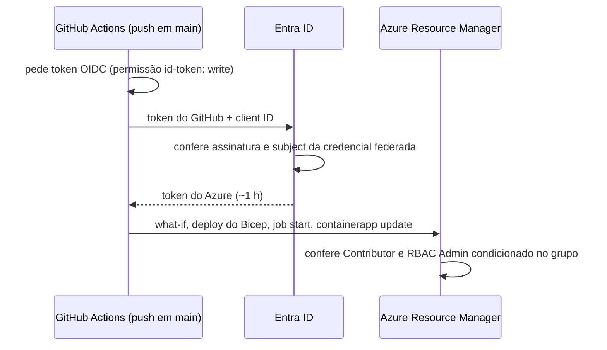

# GitHub Actions com OIDC (login sem segredo no Azure)

## 1. O que é

**OIDC** (*OpenID Connect*) é um jeito de um sistema provar quem é para outro com um token assinado de vida curta, em vez de uma senha guardada. O GitHub Actions emite, a cada execução, um token que diz "sou o workflow do repositório `milsucruz/payment-webhook-processor`, rodando no branch `main`". O Entra ID confere a assinatura do GitHub e, se uma **credencial federada** cadastrada por nós aceitar exatamente essa frase, troca o token por um token do Azure válido por cerca de uma hora.

Analogia: em vez de deixar a chave do prédio com o entregador (um segredo que pode ser copiado), a portaria liga para a empresa de entregas, confirma que aquele entregador está escalado para aquele endereço hoje e libera a entrada só durante a entrega.

Três peças:

| Peça | O que é | No nosso sistema |
| --- | --- | --- |
| **App registration** | A "conta" do pipeline no Entra ID, com um *client ID* | `github-payment-webhook-processor` |
| **Service principal** | A presença dessa conta no diretório, que recebe os papéis do RBAC | Criado junto com o app registration |
| **Credencial federada** | A regra "aceito tokens do GitHub com este `subject`" | `repo:milsucruz@103121417/payment-webhook-processor@1414394226:ref:refs/heads/main` |

**Subject com IDs imutáveis.** O repositório usa o formato padrão atual do GitHub (`use_immutable_subject: true`): o `subject` leva o ID numérico do dono (`103121417`) e o do repositório (`1414394226`) depois de cada nome. Assim, se o repositório fosse apagado e outra pessoa criasse um com o mesmo nome, o token dela teria outro ID e não entraria. O `setup-oidc.ps1` lê o prefixo de `gh api repos/<repo>/actions/oidc/customization/sub` (campo `sub_claim_prefix`) em vez de fixar os números. A tarefa 4.8 descobriu isso no ensaio: a credencial com o formato antigo (`repo:milsucruz/payment-webhook-processor:...`) recusou o login com `AADSTS700213`.

## 2. Equivalente local

Na máquina, o desenvolvedor faz `az login` no navegador, com MFA, e os comandos `az` usam essa sessão. O pipeline não tem navegador nem pessoa: o OIDC é o `az login` dele. A ação `azure/login` faz a troca de tokens e deixa o `az` logado do mesmo jeito que na máquina.

## 3. Por que ele e não a alternativa

Seção 8 ("Secretless pipeline") e NFR5: nenhum segredo de longa duração no GitHub. A alternativa clássica é um **client secret** do service principal guardado em `secrets.AZURE_CREDENTIALS`: é uma senha que vale até expirar, pode vazar num log ou num fork e precisa ser trocada. Com OIDC não há nada para vazar, e um token roubado expira em minutos.

Também descartada: uma **identidade gerenciada** user-assigned com credencial federada. Ela é um recurso do Azure e teria de morar num grupo de recursos. Em `rg-payment-webhooks`, o pipeline teria Contributor sobre a própria identidade e a perderia ao recriar o grupo; num segundo grupo, contradiria a seção 10 ("all resources go in the resource group `rg-payment-webhooks`"). O app registration é um objeto do diretório, fora de qualquer grupo, e o pipeline não tem permissão para alterá-lo.

## 4. Camada, o que não tem e quota

| Item | Valor |
| --- | --- |
| Custo | Nenhum: app registration, credencial federada e atribuições de papel são gratuitos; o Actions é grátis em repositório público |
| Quota | Até 20 credenciais federadas por app registration |
| O que não tem | *Wildcard* no `subject`: cada branch, tag ou environment precisa da sua credencial. Por isso o ensaio da tarefa 4.8 numa branch exigiu uma credencial temporária |
| Papéis | Contributor no grupo e Role Based Access Control Administrator **com condição** (seção 8) |

**Por que dois papéis.** Contributor cria e altera recursos, mas não tem `Microsoft.Authorization/roleAssignments/write`, e o Bicep cria atribuições de papel (as cinco das filas e a do Key Vault). O RBAC Administrator dá essa ação, e a **condição** limita quais papéis ele pode atribuir ou remover: só Azure Service Bus Data Sender (`69a216fc-…`), Data Receiver (`4f6d3b9b-…`) e Key Vault Secrets User (`4633458b-…`). Sem a condição, o pipeline poderia dar Owner a si mesmo.

```text
(
 (!(ActionMatches{'Microsoft.Authorization/roleAssignments/write'}))
 OR
 (@Request[Microsoft.Authorization/roleAssignments:RoleDefinitionId] ForAnyOfAnyValues:GuidEquals {69a216fc-..., 4f6d3b9b-..., 4633458b-...})
)
AND
(
 (!(ActionMatches{'Microsoft.Authorization/roleAssignments/delete'}))
 OR
 (@Resource[Microsoft.Authorization/roleAssignments:RoleDefinitionId] ForAnyOfAnyValues:GuidEquals {69a216fc-..., 4f6d3b9b-..., 4633458b-...})
)
```

Lê-se: "se a ação é criar uma atribuição, o papel pedido tem de estar na lista; se é apagar, o papel da atribuição existente tem de estar na lista". Qualquer outra ação do papel (ler atribuições, por exemplo) passa.

## 5. Como entra no nosso sistema



Exemplo concreto: um merge em `main` dispara o `deploy.yml`. O passo `azure/login` lê `vars.AZURE_CLIENT_ID`, `vars.AZURE_TENANT_ID` e `vars.AZURE_SUBSCRIPTION_ID` (identificadores públicos, não segredos) e troca o token. Quando o Bicep chega em `servicebus.bicep` e grava a atribuição "Data Sender para `id-payment-webhooks-api` na fila `payment-events`", o Azure avalia a condição: o papel é `69a216fc-…`, está na lista, passa. Se alguém mudasse o Bicep para atribuir Owner, o deploy falharia com `AuthorizationFailed`.

Um push numa branch qualquer ou um pull request gera um token com outro `subject` (`ref:refs/heads/<branch>` ou `pull_request`), que nenhuma credencial aceita: por isso o `ci.yml` nunca faz login no Azure.

## 6. Glossário

| Termo | Significado |
| --- | --- |
| OIDC | Protocolo de identidade sobre OAuth 2.0; aqui, o token que o GitHub emite para cada execução |
| Issuer | Quem emite o token: `https://token.actions.githubusercontent.com` |
| Subject (`sub`) | Quem o token diz ser: `repo:<dono>@<id>/<repo>@<id>:ref:refs/heads/main` |
| Subject imutável | Formato do `sub` com os IDs numéricos do dono e do repositório, que não mudam com renomeação nem são reaproveitados |
| Audience (`aud`) | Para quem o token é: `api://AzureADTokenExchange` |
| Credencial federada | Regra no app registration que aceita um issuer, subject e audience exatos |
| App registration | O registro de uma aplicação no Entra ID; dá o client ID |
| Service principal | A instância do app registration no diretório; é quem recebe papéis |
| Client ID | Identificador público do app registration; vai em `vars.AZURE_CLIENT_ID` |
| `id-token: write` | Permissão do workflow que deixa o job pedir o token OIDC |
| Variável do repositório | Valor não secreto (`vars.*`), visível a quem administra o repositório e impresso nos logs |
| Secret do repositório | Valor cifrado (`secrets.*`); o projeto não guarda nenhum |
| Condição de ABAC | Expressão que restringe uma atribuição de papel; aqui, os papéis que o pipeline pode atribuir |

## 7. O que pode dar errado e quanto custa errar

- **Subject errado:** o login falha com `AADSTS700213: No matching federated identity record found`. Custo: nenhum. O erro mostra o subject recebido; basta compará-lo com a credencial. Aconteceu na 4.8: a credencial tinha o formato sem IDs, e o GitHub emite o imutável.
- **Credencial larga demais:** um subject de outro repositório ou de qualquer branch daria o grupo de recursos a quem empurrar código ali. Mantemos só `main` e apagamos a credencial temporária do ensaio. Conferir com `az ad app federated-credential list`.
- **RBAC Administrator sem condição:** o pipeline poderia se dar Owner na assinatura? Não, o escopo é o grupo, mas poderia se dar Owner no grupo, ou dar papéis de dados a qualquer um. A condição é o que impede.
- **Papel novo no Bicep:** se uma tarefa futura atribuir um papel fora da lista (por exemplo, Monitoring Metrics Publisher, pendência 4.4), o deploy falha com `AuthorizationFailed` até a condição e a seção 8 ganharem o papel.
- **Dados pessoais em log público:** o repositório é público, então os logs do Actions também são. O e-mail do admin do SQL é mascarado (`::add-mask::`) e o deploy roda com `--output none`, porque a saída do `az deployment group create` imprime os parâmetros.
- **Recriar o grupo de recursos:** apaga as duas atribuições do pipeline (elas vivem no grupo). O app registration sobrevive; basta refazer as atribuições.
- **Desfazer:** apagar a credencial federada corta o acesso na hora; apagar o app registration apaga também o service principal e as atribuições ficam órfãs (o portal as mostra como "Unknown").

## 8. Como conferir

```bash
az ad app list --display-name github-payment-webhook-processor --query "[].{name:displayName,clientId:appId}" -o table
az ad app federated-credential list --id <clientId> --query "[].{name:name,subject:subject}" -o table
az role assignment list -g rg-payment-webhooks --assignee <clientId> --query "[].{role:roleDefinitionName,condition:condition}" -o json
gh variable list        # AZURE_CLIENT_ID, AZURE_TENANT_ID, AZURE_SUBSCRIPTION_ID, SQL_ADMIN_LOGIN, SQL_ADMIN_OBJECT_ID
gh secret list          # vazio: o pipeline não guarda segredo
gh run list --workflow deploy.yml --limit 5
```

No portal: **Microsoft Entra ID** → **App registrations** → `github-payment-webhook-processor` → **Certificates & secrets** → **Federated credentials** (e a aba **Client secrets** vazia). No grupo de recursos: **Access control (IAM)** → **Role assignments**, onde o RBAC Administrator aparece com a coluna **Condition**.
