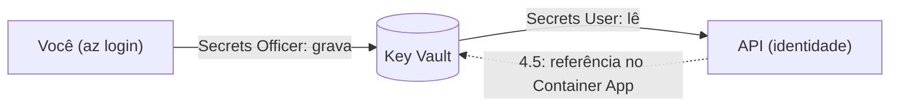

# Azure Key Vault

## 1. O que é

Um cofre para segredos (senhas, chaves, tokens). Quem tem permissão lê o valor; ninguém mais vê, e cada acesso fica registrado. Analogia: o cofre do hotel: o segredo não fica no quarto (código, imagem, repositório), fica no cofre, e o hóspede (a API) recebe uma chave só para abrir a gaveta que lhe cabe.

## 2. Equivalente local

`dotnet user-secrets` para o código rodando fora do compose e o `.env` (git-ignorado) para o compose. Nos dois casos o segredo fica na máquina do desenvolvedor, nunca no repositório. Na nuvem esse papel é do Key Vault.

## 3. Por que ele e não a alternativa

NFR5: nenhuma credencial no código, na imagem ou no repositório. As alternativas descartadas: variável de ambiente escrita no Bicep (o valor ficaria no repositório e no histórico de deploys) e segredo guardado no GitHub (o pipeline é sem segredo, seção 8). Custo: cobrança por 10.000 operações, centavos neste volume (seção 10).

## 4. Camada escolhida

| Item | Valor |
| --- | --- |
| SKU | `standard` (a `premium` só acrescenta chaves protegidas por HSM, que não usamos) |
| Autorização | RBAC (`enableRbacAuthorization: true`), não as "access policies" antigas: as permissões são role assignments, como no resto do projeto |
| Soft delete | Sempre ligado, 90 dias; um cofre apagado fica recuperável e **continua reservando o nome** |
| Purge protection | **Desligada**: ligada, ela não pode ser desfeita e impede apagar o cofre de vez por 90 dias, e este ambiente já foi recriado uma vez |
| Cota gratuita | Não há; paga-se por operação (cerca de US$ 0,03 por 10.000 em segredos) |
| Quando acaba | Não acaba: o limite é de requisições por segundo, não de franquia |

## 5. Como entra no nosso sistema



Dois segredos (seção 8): `stripe-webhook-secret` (assinatura do webhook) e `admin-api-key` (botão de reprocessar). Só a API os lê, com o papel **Key Vault Secrets User** no cofre. O worker não lê nenhum.

Exemplo: na tarefa 4.5 o Container App da API declara `Admin__ApiKey` como referência ao segredo `admin-api-key`; ao iniciar, a plataforma usa a identidade da API para ler o valor e o injeta como variável. O valor nunca passa pelo Bicep nem pelo pipeline.

**Quem grava.** O Bicep cria o cofre e as permissões, mas **não** os valores: um valor num template ficaria no repositório. Os valores entram com `az keyvault secret set`, por quem tem o papel **Key Vault Secrets Officer** (concedido à mão ao desenvolvedor, como a regra de firewall do SQL). O `stripe-webhook-secret` entra como marcador na 4.4, para a referência da 4.5 resolver, e com o valor real na 4.9; gravar de novo cria uma versão nova.

## 6. Glossário

| Termo | Significado |
| --- | --- |
| Vault | O cofre; o nome vira `https://<nome>.vault.azure.net` e é único no mundo |
| Secret | Um valor guardado, com versões |
| Versão | Cada gravação do mesmo nome cria uma; a referência sem versão usa a mais recente |
| Soft delete | Apagar marca como apagado e guarda 90 dias antes de remover |
| Purge | Remoção definitiva de um cofre em soft delete |
| Secrets User | Papel que só lê o valor dos segredos |
| Secrets Officer | Papel que lê, grava e apaga segredos |
| Plano de dados | Ler e gravar os segredos; o papel Owner da assinatura **não** dá acesso a ele |

## 7. O que pode dar errado e quanto custa errar

- **Nome em uso:** o nome tem no máximo 24 caracteres e é global. Apagar o grupo de recursos deixa o cofre em soft delete, e recriar o ambiente com o mesmo nome falha com `VaultAlreadyExists` até `az keyvault purge`. Custo: tempo, não dinheiro.
- **Sem acesso ao próprio cofre:** ser Owner da assinatura não permite ler segredos; sem o papel de Officer o `secret set` devolve `Forbidden`.
- **Segredo no terminal:** o valor aparece no histórico do shell e na saída se for impresso. Grave por variável ou arquivo temporário e não cole em chat ou commit.
- **Purge protection:** ligar é irreversível. Não ligamos.
- **Cobrança:** centavos. O risco real é vazar o segredo, não gastar.

## 8. Como conferir

```bash
az keyvault show -n <cofre> --query "{rbac:properties.enableRbacAuthorization,softDelete:properties.enableSoftDelete,purgeProtection:properties.enablePurgeProtection,sku:properties.sku.name}"
az keyvault secret list --vault-name <cofre> --query "[].name"
az role assignment list --scope $(az keyvault show -n <cofre> --query id -o tsv) --query "[].{role:roleDefinitionName,who:principalName}"
az keyvault list-deleted -o table   # cofres em soft delete que seguram um nome
```

No portal: o cofre → **Objects → Secrets** e **Access control (IAM)**.
