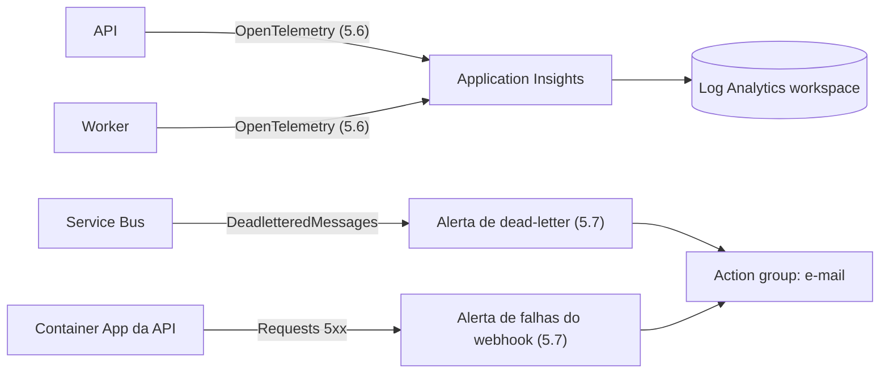

# Log Analytics e Application Insights

## 1. O que é

**Log Analytics workspace** é o depósito: um banco onde logs e métricas são guardados e consultados com KQL. **Application Insights** é o painel de aplicação em cima desse depósito: traces, requisições, falhas e métricas das nossas duas aplicações. Analogia: o workspace é o arquivo morto da empresa; o Application Insights é a sala de monitoramento que lê esse arquivo.

## 2. Equivalente local

O console do Docker Compose (`docker compose logs`), com logs do .NET e do EF Core. Não há traces nem métricas locais; elas só passam a existir com o OpenTelemetry da tarefa 5.6.

## 3. Por que ele e não a alternativa

A seção 9 pede um trace único do evento (API → fila → worker → banco) e cinco métricas próprias. O Application Insights com o exportador do Azure Monitor para OpenTelemetry entrega isso sem servidor para operar, e a franquia gratuita de ingestão cobre o volume de teste. Alternativas como Grafana, Prometheus e Jaeger exigiriam hospedar e pagar por isso.

## 4. Camada escolhida

| Item | Valor |
| --- | --- |
| Workspace | SKU `PerGB2018` (pague pelo que ingerir) |
| Retenção | 30 dias |
| Cota gratuita | Primeiros 5 GB de ingestão por mês |
| Teto diário | `dailyQuotaGb: 0.2` (seção 9) |
| Application Insights | Baseado em workspace (`WorkspaceResourceId`); não tem armazenamento nem cota próprios |

**O que o teto faz.** Ao chegar a 0,2 GB no dia, o workspace **para de ingerir** até a hora de reinício; logs e traces desse intervalo são perdidos, o dinheiro não. Atenção à conta: 0,2 GB × 31 dias = 6,2 GB, mais que os 5 GB gratuitos. No pior caso, todo dia no teto, sobra cerca de 1,2 GB cobrado, uns US$ 3, dentro do orçamento de US$ 5. O teto é uma proteção contra explosão (um loop de log), não uma garantia de custo zero.

## 5. Como entra no nosso sistema



Exemplo: um webhook chega, a API abre o span `POST /webhooks/stripe`, o worker continua o trace ao processar a mensagem. Cada span é enviado ao Application Insights e fica no workspace, onde uma consulta KQL como `requests | where success == false` os lista. Na 4.4 só os recursos existem; nada envia dados ainda.

### Métricas próprias e alertas (tarefa 5.7)

**Métricas próprias.** As cinco métricas da seção 9 (`events.received`, `events.duplicate`, `events.out_of_order`, `events.dead_lettered`, `event.processing.duration`) saem pelo mesmo exportador dos traces e chegam à tabela `customMetrics`, agregadas por minuto. Exemplo: a cada minuto, o worker manda "3 duplicados" com a soma, a contagem, o mínimo e o máximo das durações. Consulta: `customMetrics | where name == "events.duplicate" | summarize sum(valueSum) by bin(timestamp, 1h)`.

**Alertas.** Um alerta de métrica (*metric alert*) é uma regra do Azure Monitor que olha uma métrica de **plataforma** (que o próprio recurso do Azure emite, sem código nosso e sem passar pelo workspace) a cada minuto e, se a condição for verdadeira, chama um **action group**, que manda o e-mail. Analogia: o alarme de fumaça; ele não depende de alguém da casa ligar para os bombeiros. Temos dois:

| Alerta | Métrica | Condição | Por que essa métrica |
| --- | --- | --- | --- |
| Dead-letter | `DeadletteredMessages` do namespace, dimensão `EntityName = payment-events` | máximo > 0 em 5 min | Conta toda mensagem na dead-letter, inclusive a que o próprio Service Bus moveu depois de 5 entregas (`MaxDeliveryCountExceeded`), que o código nunca vê |
| Falhas do webhook | `Requests` do Container App da API, dimensão `statusCodeCategory = 5xx` | total > 5 em 5 min | Contada pelo ingress: pega até o 502/503 de uma API que nem subiu |

Exemplo do fluxo: um pagamento `poison` falha 5 vezes no worker, o Service Bus o move para a dead-letter, `DeadletteredMessages` vai de 0 a 1, na avaliação seguinte o alerta dispara e o action group manda o e-mail.

**Stateful.** O alerta dispara **uma vez** e fica "disparado" enquanto a condição for verdadeira; ele se resolve sozinho quando ela volta a ser falsa. Com a dead-letter sempre acima de zero, um segundo `poison` **não** manda outro e-mail. Para o alerta voltar a avisar, a dead-letter precisa ser esvaziada: reprocessando pelo painel ou com `infra/servicebus/purge-dead-letters.ps1`.

## 6. Glossário

| Termo | Significado |
| --- | --- |
| Workspace | Depósito de dados de monitoramento |
| KQL | Linguagem de consulta do workspace |
| Ingestão | Dados que entram e são cobrados por GB |
| Retenção | Quantos dias o dado fica guardado |
| Teto diário (*daily cap*) | Limite de GB por dia, depois do qual a ingestão para |
| Connection string | Texto com a chave de ingestão e o endpoint do Application Insights |
| Span / trace | Um passo / a cadeia completa de passos de um evento |
| Métrica de plataforma | Métrica que o próprio recurso do Azure emite (ex.: `DeadletteredMessages`), sem código nosso |
| Métrica própria (*custom metric*) | Métrica que o nosso código emite, na tabela `customMetrics` |
| Alerta de métrica | Regra que avalia uma métrica de plataforma a cada minuto e chama o action group |
| Action group | Lista de quem avisar e como (aqui, um e-mail) |
| Stateful / `autoMitigate` | O alerta dispara uma vez e se resolve sozinho quando a condição deixa de ser verdadeira |

## 7. O que pode dar errado e quanto custa errar

- **Teto estourado cedo:** um log ruidoso enche os 0,2 GB e o resto do dia fica sem telemetria. A 5.6 tirou as fontes conhecidas: o polling do Service Bus não vira span, os duplicados não geram `Error` do EF e os retries e falhas de health check saem sem stack.
- **Cobrança:** passa de 5 GB/mês só se o teto ficar quase todo dia no limite (ver conta acima).
- **Connection string:** contém uma chave de ingestão. Desde a 5.6 o recurso tem `DisableLocalAuth: true`, então a chave sozinha não envia nada: só identidades com o papel Monitoring Metrics Publisher (as do API e do worker) enviam, e a connection string virou só um identificador, passado como variável comum. Se o papel faltar, o exporter não derruba o app, mas a telemetria simplesmente não chega ao portal.
- **Logo depois do deploy:** a atribuição do Monitoring Metrics Publisher pode levar alguns minutos para valer. Nesse intervalo a ingestão recusa o token, e a telemetria desses minutos pode se perder; o app continua funcionando.
- **Desfazer:** apagar o workspace apaga os dados e tem uma janela de recuperação de 14 dias; apagar o Application Insights não apaga o workspace.
- **Alertas (5.7):** cada regra de métrica custa cerca de US$ 0,10 por mês (uma série monitorada); os primeiros 1.000 e-mails por mês são grátis. Um alerta de log (KQL) custaria cerca de US$ 1,50 por mês por regra, por isso os dois são de métrica. Apagar as regras e o action group não tem efeito colateral.
- **Alerta que nunca mais avisa:** com a dead-letter cheia, o alerta continua disparado e não manda novos e-mails (ver "Stateful" acima).
- **E-mail do alerta:** é pessoal e não fica no repositório público. O Bicep o lê de `ALERT_EMAIL`, e o pipeline o lê do próprio action group, como faz com o admin do SQL.

## 8. Como conferir

```bash
az monitor log-analytics workspace show -g rg-payment-webhooks -n <workspace> --query "{sku:sku.name,retention:retentionInDays,capGb:workspaceCapping.dailyQuotaGb}"
az monitor app-insights component show -g rg-payment-webhooks --app <appinsights> --query "{kind:kind,workspace:workspaceResourceId,localAuthDisabled:disableLocalAuth}"
az rest --method post --url "https://api.loganalytics.io/v1/workspaces/$(az resource show -g rg-payment-webhooks -n log-payment-webhooks --resource-type Microsoft.OperationalInsights/workspaces --query properties.customerId -o tsv)/query" --resource https://api.loganalytics.io --body "{\"query\": \"union AppRequests, AppDependencies | where OperationId == '<trace ID>' | order by TimeGenerated asc | project TimeGenerated, AppRoleName, Name, Id, ParentId\"}" --query "tables[0].rows" -o tsv   # spans de um trace
```

```bash
az monitor metrics alert list -g rg-payment-webhooks --query "[].{name:name,enabled:enabled,severity:severity}" -o table
az monitor action-group show -g rg-payment-webhooks -n ag-payment-webhooks --query "emailReceivers[].{name:name,status:status}"
az servicebus queue show -g rg-payment-webhooks --namespace-name <namespace> -n payment-events --query countDetails.deadLetterMessageCount
```

No portal: o workspace → **Usage and estimated costs → Daily cap**; **Monitor → Alerts** mostra os alertas disparados e resolvidos.
