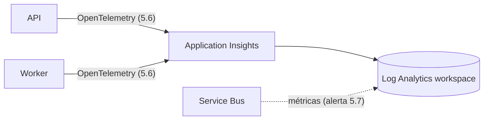

# Log Analytics e Application Insights

## 1. O que é

**Log Analytics workspace** é o depósito: um banco onde logs e métricas são guardados e consultados com KQL. **Application Insights** é o painel de aplicação em cima desse depósito: traces, requisições, falhas e métricas das nossas duas aplicações. Analogia: o workspace é o arquivo morto da empresa; o Application Insights é a sala de monitoramento que lê esse arquivo.

## 2. Equivalente local

O console do Docker Compose (`docker compose logs`), com logs do .NET e do EF Core. Não há traces nem métricas locais; elas só passam a existir com o OpenTelemetry da tarefa 5.6.

## 3. Por que ele e não a alternativa

A seção 9 pede um trace único do evento (API → fila → worker → banco) e cinco métricas próprias. O Application Insights com o exportador do Azure Monitor para OpenTelemetry entrega isso sem servidor para operar, e a franquia gratuita de ingestão cobre o volume de teste. Alternativas como Grafana, Prometheus e Jaeger exigiriam hospedar e pagar por isso.

## 4. Camada escolhida

| Item | Valor |
| --- | --- |
| Workspace | SKU `PerGB2018` (pague pelo que ingerir) |
| Retenção | 30 dias |
| Cota gratuita | Primeiros 5 GB de ingestão por mês |
| Teto diário | `dailyQuotaGb: 0.2` (seção 9) |
| Application Insights | Baseado em workspace (`WorkspaceResourceId`); não tem armazenamento nem cota próprios |

**O que o teto faz.** Ao chegar a 0,2 GB no dia, o workspace **para de ingerir** até a hora de reinício; logs e traces desse intervalo são perdidos, o dinheiro não. Atenção à conta: 0,2 GB × 31 dias = 6,2 GB, mais que os 5 GB gratuitos. No pior caso, todo dia no teto, sobra cerca de 1,2 GB cobrado, uns US$ 3, dentro do orçamento de US$ 5. O teto é uma proteção contra explosão (um loop de log), não uma garantia de custo zero.

## 5. Como entra no nosso sistema



Exemplo: um webhook chega, a API abre o span `POST /webhooks/stripe`, o worker continua o trace ao processar a mensagem. Cada span é enviado ao Application Insights e fica no workspace, onde uma consulta KQL como `requests | where success == false` os lista. Na 4.4 só os recursos existem; nada envia dados ainda.

## 6. Glossário

| Termo | Significado |
| --- | --- |
| Workspace | Depósito de dados de monitoramento |
| KQL | Linguagem de consulta do workspace |
| Ingestão | Dados que entram e são cobrados por GB |
| Retenção | Quantos dias o dado fica guardado |
| Teto diário (*daily cap*) | Limite de GB por dia, depois do qual a ingestão para |
| Connection string | Texto com a chave de ingestão e o endpoint do Application Insights |
| Span / trace | Um passo / a cadeia completa de passos de um evento |

## 7. O que pode dar errado e quanto custa errar

- **Teto estourado cedo:** um log ruidoso enche os 0,2 GB e o resto do dia fica sem telemetria. A 5.6 tirou as fontes conhecidas: o polling do Service Bus não vira span, os duplicados não geram `Error` do EF e os retries e falhas de health check saem sem stack.
- **Cobrança:** passa de 5 GB/mês só se o teto ficar quase todo dia no limite (ver conta acima).
- **Connection string:** contém uma chave de ingestão. Desde a 5.6 o recurso tem `DisableLocalAuth: true`, então a chave sozinha não envia nada: só identidades com o papel Monitoring Metrics Publisher (as do API e do worker) enviam, e a connection string virou só um identificador, passado como variável comum. Se o papel faltar, o exporter não derruba o app, mas a telemetria simplesmente não chega ao portal.
- **Logo depois do deploy:** a atribuição do Monitoring Metrics Publisher pode levar alguns minutos para valer. Nesse intervalo a ingestão recusa o token, e a telemetria desses minutos pode se perder; o app continua funcionando.
- **Desfazer:** apagar o workspace apaga os dados e tem uma janela de recuperação de 14 dias; apagar o Application Insights não apaga o workspace.

## 8. Como conferir

```bash
az monitor log-analytics workspace show -g rg-payment-webhooks -n <workspace> --query "{sku:sku.name,retention:retentionInDays,capGb:workspaceCapping.dailyQuotaGb}"
az monitor app-insights component show -g rg-payment-webhooks --app <appinsights> --query "{kind:kind,workspace:workspaceResourceId,localAuthDisabled:disableLocalAuth}"
az rest --method post --url "https://api.loganalytics.io/v1/workspaces/$(az resource show -g rg-payment-webhooks -n log-payment-webhooks --resource-type Microsoft.OperationalInsights/workspaces --query properties.customerId -o tsv)/query" --resource https://api.loganalytics.io --body "{\"query\": \"union AppRequests, AppDependencies | where OperationId == '<trace ID>' | order by TimeGenerated asc | project TimeGenerated, AppRoleName, Name, Id, ParentId\"}" --query "tables[0].rows" -o tsv   # spans de um trace
```

No portal: o workspace → **Usage and estimated costs → Daily cap**.
