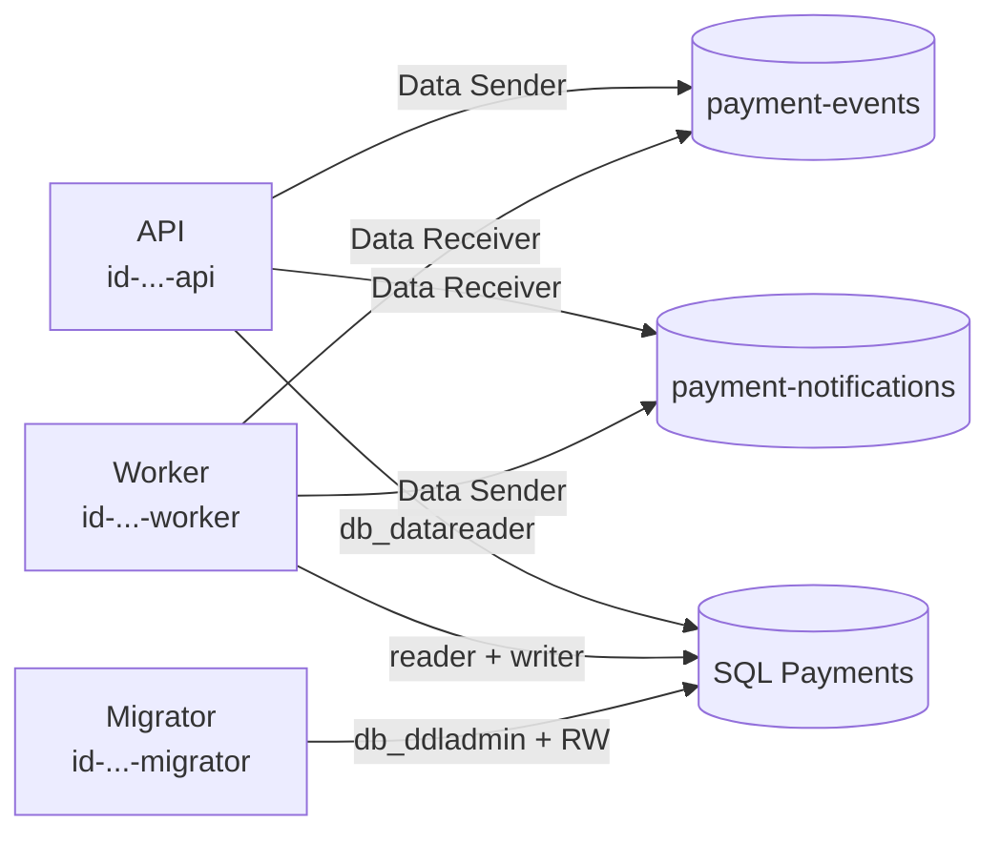

# Identidade gerenciada e RBAC

## 1. O que é

**Identidade gerenciada** é um "crachá" que o Azure cria e guarda para um programa. O programa não tem senha: ele mostra o crachá ao Azure, que sabe quem ele é. **RBAC** (controle de acesso baseado em papéis) é a lista de portas que cada crachá abre. Um papel é um conjunto de permissões (ex.: "enviar mensagens") e uma atribuição de papel liga um crachá, um papel e um lugar (o escopo).

Analogia: o crachá do funcionário abre a sala dele, mas não o cofre. Quem perde o crachá pede outro; ninguém precisa trocar a fechadura.

## 2. Equivalente local

Localmente o projeto usa a senha do `sa` do SQL Server e a connection string do emulador do Service Bus, guardadas em `.env` e `user-secrets`. Na nuvem essas senhas deixam de existir: o código se autentica com a identidade (`DefaultAzureCredential`), e nada secreto vai para imagem, variável de ambiente ou repositório (NFR5, seção 8).

## 3. Por que ele e não a alternativa

Decisão 10 da seção 12: identidade gerenciada em vez de connection strings. Uma connection string é uma senha que pode vazar e precisa ser trocada; a identidade não pode ser copiada para fora do Azure e não precisa de rotação. Descartada também a chave de acesso do Service Bus (`disableLocalAuth: true` desliga esse caminho de vez).

## 4. Tipo, escopo e o que ela não tem

- **User-assigned** (criada por nós, como recurso próprio), não system-assigned. Motivo: a identidade existe antes do container, então o Bicep pode atribuir papéis a ela antes de criar o Container Apps, e ela sobrevive a recriar o app.
- Três identidades, uma por responsabilidade: `api`, `worker`, `migrator`. A API não escreve no banco; se o endpoint público for comprometido, o dano fica limitado.
- Papéis atribuídos no menor escopo útil: a **fila**, não o namespace. Tabela completa na seção 8 da arquitetura.
- Identidade gerenciada não tem custo.

## 5. Como entra no nosso sistema



Exemplo: o worker termina de aplicar um evento e publica o aviso em `payment-notifications`. Ele pede um token ao Azure como `id-payment-webhooks-worker`; o Service Bus consulta a atribuição "Data Sender nesta fila" e aceita. Se o worker tentasse enviar para `payment-events`, seria recusado, porque não tem atribuição ali.

## 6. Glossário

| Termo | Significado |
| --- | --- |
| Principal | Quem pede acesso (aqui, uma identidade gerenciada) |
| `principalId` | ID da identidade no Entra ID; é o que o RBAC usa |
| `clientId` | ID da aplicação da identidade; vira o SID do usuário no SQL (ver `azure-sql.md`) |
| Escopo | Onde o papel vale: assinatura, grupo de recursos, recurso (aqui, cada fila) |
| Role definition | O papel em si, identificado por um GUID fixo do Azure |
| Role assignment | A ligação principal + papel + escopo; é um recurso com nome (GUID) |
| Entra ID | O diretório de identidades do Azure (antigo Azure AD) |

## 7. O que pode dar errado e quanto custa errar

- **Custo:** nenhum. Identidades e atribuições são gratuitas.
- **Propagação:** uma atribuição nova pode levar minutos para valer. Erro de autorização logo após o deploy não é necessariamente bug.
- **GUID do papel errado:** aconteceu (na 4.2 o id do Data Receiver do plano estava errado). Sempre confirmar com `az role definition list --name "Azure Service Bus Data Receiver"`.
- **Nome da atribuição:** precisa ser determinístico (`guid(escopo, identidade, papel)`), senão cada deploy tenta criar uma nova e falha.
- **Quem cria atribuições:** exige `Microsoft.Authorization/roleAssignments/write`, que o Contributor não tem. Por isso a pipeline (4.8) terá o papel Role Based Access Control Administrator com condição.
- **Desfazer:** apagar a atribuição é imediato e seguro; recriar a identidade gera um `principalId` novo, e as atribuições e o usuário no SQL precisam ser refeitos.

## 8. Como conferir

```bash
az identity list -g rg-payment-webhooks -o table
az role assignment list --all --assignee <principalId> -o table
az role assignment list --scope <id-da-fila> -o table
az role definition list --name "Azure Service Bus Data Sender" --query "[].{id:name,role:roleName}" -o table
```

No portal: o recurso da fila → **Access control (IAM)** → **Role assignments**.
