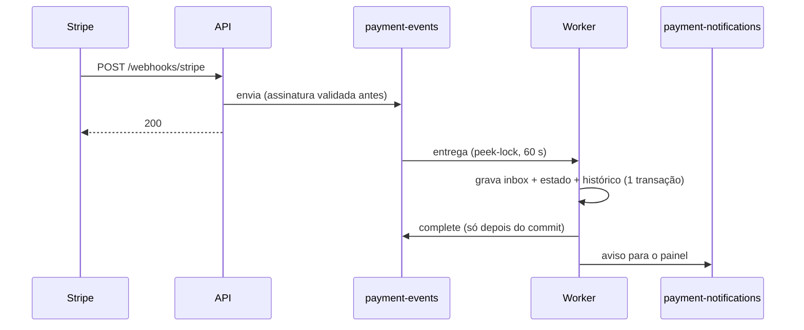

# Azure Service Bus (camada Basic)

## 1. O que é

Um serviço de filas gerenciado. Quem produz uma mensagem a coloca na fila e segue a vida; quem consome a pega quando puder. Se o consumidor cai, a mensagem espera. Analogia: a caixa de correio do prédio. O carteiro (a API) deixa a carta e vai embora; o morador (o worker) busca quando chega.

## 2. Equivalente local

O emulador do Service Bus no `docker compose`, configurado por `infra/servicebus-emulator/config.json`. O código é o mesmo; muda só a forma de se autenticar (connection string do emulador localmente, identidade gerenciada na nuvem).

## 3. Por que ele e não a alternativa

- Decisão 1: a fila entre API e worker. O Stripe exige resposta rápida e a API não grava no banco no caminho do webhook; a fila absorve picos.
- Decisão 2: Service Bus em vez de Storage Queues ou Event Grid. Dead-letter nativo, peek-lock e contagem de entregas, que são o assunto do estudo.
- Decisão 3: Basic com idempotência na aplicação. O inbox é necessário de qualquer forma, e o Standard tem taxa fixa.

## 4. Camada escolhida: Basic

| Item | Valor |
| --- | --- |
| Cobrança | Por milhão de operações, sem taxa fixa; centavos neste volume |
| Tem | Filas, peek-lock, dead-letter, contagem de entregas, TTL |
| Não tem | Tópicos/assinaturas, sessões, detecção de duplicatas |
| Standard | **Não criar, nem para testar**: tem taxa fixa por hora |

Configuração das filas (seção 6 da arquitetura):

| Parâmetro | `payment-events` | `payment-notifications` |
| --- | --- | --- |
| Lock | 60 s | 60 s |
| Entregas máximas | 5 | 5 |
| TTL | 14 dias | 1 minuto |
| Dead-letter ao expirar | **Sim** | Não |

Por que a diferença: um evento expirado sem dead-letter some em silêncio e o pagamento nunca é aplicado (NFR3). Já um aviso do painel que expira em 1 minuto perdeu a utilidade de propósito; guardá-lo só criaria lixo.

## 5. Como entra no nosso sistema



Exemplo: se o worker cair entre o commit e o `complete`, o lock de 60 s vence, a mensagem volta e é entregue de novo; o inbox reconhece o `evt_...` e descarta o duplicado. Depois de 5 entregas sem sucesso a mensagem vai para a dead-letter com motivo `MaxDeliveryCountExceeded`.

## 6. Glossário

| Termo | Significado |
| --- | --- |
| Namespace | O "servidor" do Service Bus; contém as filas. Nome único global |
| Fila (queue) | Um canal ponto a ponto |
| Peek-lock | Ler a mensagem a trava por um tempo; só some da fila quando é completada |
| Lock duration | Quanto tempo a trava dura antes da mensagem voltar |
| Complete / Abandon | Confirmar o processamento / devolver a mensagem à fila |
| Delivery count | Quantas vezes a mensagem foi entregue |
| Dead-letter (DLQ) | Subfila para mensagens que não podem ser processadas, com o motivo |
| TTL | Tempo de vida da mensagem na fila |
| `disableLocalAuth` | Desliga as chaves SAS; só Entra ID/identidade funciona |

## 7. O que pode dar errado e quanto custa errar

- **Cobrança:** quase nenhuma na Basic. O erro caro é criar o namespace em Standard (taxa por hora).
- **Nome do namespace:** é global. O Bicep usa `uniqueString(resourceGroup().id)` para não colidir.
- **Dead-letter ao expirar:** o padrão é desligado. Esquecer isso em `payment-events` perde eventos sem aviso.
- **Provedores:** `Microsoft.ServiceBus` precisa estar registrado na assinatura (na 4.2 foi preciso registrar à mão).
- **Desfazer:** apagar o namespace apaga as mensagens. Os de teste são descartáveis; o de produção não é.

## 8. Como conferir

```bash
az servicebus namespace show -g rg-payment-webhooks -n <namespace> --query "{sku:sku.name,localAuthOff:disableLocalAuth}"
az servicebus queue show -g rg-payment-webhooks --namespace-name <namespace> -n payment-events --query "{dlq:deadLetteringOnMessageExpiration,max:maxDeliveryCount,ttl:defaultMessageTimeToLive,lock:lockDuration}"
az servicebus queue show -g rg-payment-webhooks --namespace-name <namespace> -n payment-notifications --query "{dlq:deadLetteringOnMessageExpiration,ttl:defaultMessageTimeToLive}"
```

No portal: o namespace → **Queues** → a fila → **Overview** (mensagens ativas e em dead-letter) e **Service Bus Explorer** para espiar mensagens.
